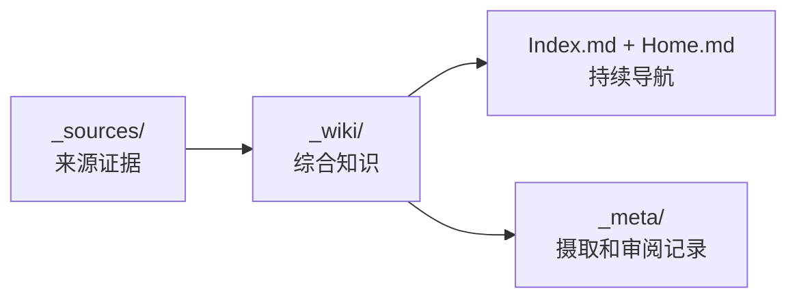

# Wei-Book 📚

> **Personal reading notes, book summaries, and reflections across software engineering, architecture, game theory, systems thinking, and personal growth.**
> 
> 个人读书笔记与精读思考：专注于博弈论、系统思维、计算机底座、软件架构、分布式与高并发、工程实践及个人认知成长的沉淀。

---

## LLM Wiki 知识入口

**[打开 Wiki 知识地图](_wiki/Home.md)** · **[总索引](Index.md)** · [迁移计划](_meta/migration-plan.md) · [维护规则](AGENTS.md)

知识采用三个明确的层次。对话、文章及摘录首先作为来源保存，经过核验和综合后写入可复用的 Wiki 页面，并通过索引和引用持续维护：



| 已编译的知识 | 处理的问题 |
| --- | --- |
| [秦统一与秦朝速亡](_wiki/History/Questions/秦统一与秦朝速亡.md) | 六国联盟博弈、秦制、帝国治理与秦罗比较 |
| [胜利后的战略转型](_wiki/SystemsThinking/胜利后的战略转型.md) | 主要矛盾的阶段变化、旧策略路径依赖与系统反馈 |

> 下文保留既有精读笔记及历史链接。它们仍然可以阅读，但在核验来源并编译前，暂不视为 `_wiki/` 的正式知识页。

---

## 📖 内容目录

```text
Wei-Book/
├── Index.md                 # 主索引
├── AGENTS.md                # LLM Wiki 维护规则
├── _sources/                # 原始来源、对话与剪藏
├── _wiki/                   # 可复用、可追溯的知识层
│   ├── Home.md              # 知识地图
│   ├── History/Questions/    # 历史问题的综合答案
│   └── SystemsThinking/     # 可复用系统概念
├── _meta/                   # 摄取清单、迁移计划和维护日志
├── game-theory/             # 博弈论与决策科学（经典博弈模型、市场机制、行为博弈）
│   ├── centipede-game.md            # 蜈蚣博弈
│   ├── greater-fool-theory.md       # 博傻理论
│   ├── grossman-stiglitz-paradox.md # 格罗斯曼-斯蒂格利茨悖论
│   ├── reflexivity-theory.md        # 索罗斯反身性理论
│   └── utility-vs-speculation.md    # 效用认知与投机风控准则
├── systems-thinking/        # 系统思维与复杂性（反身性、因果网络、动态反馈）
│   ├── action-and-control-in-complex-systems.md # 行动与控制的统一框架（斯多葛/佛家/道家）
│   ├── buddhism-daoism-reflexivity.md          # 缘起、反作用与反身性（佛道因果与控制力施加）
│   ├── destiny-as-dynamic-systems.md           # 命运作为动态生成过程（缘起、道家无为与系统建模）
│   ├── qin-unification-strategy-transition.md  # 秦灭六国：战略博弈与国家治理转型
│   └── reflexivity-causality-and-destiny.md    # 命运作为动态反馈系统
└── templates/
    └── book-note-template.md        # 读书笔记标准模板
```

---

## 🗂️ 既有精读笔记（legacy，逐批编译）

### 1. 博弈论与决策科学 (Game Theory)
| 专题 / 模型 | 核心概念 | 状态 | 笔记链接 |
| :--- | :--- | :---: | :--- |
| **蜈蚣博弈 (Centipede Game)** | 动态博弈、逆向归纳法悖论、信任与有限理性 | ✅ 已精读 | [查看笔记](game-theory/centipede-game.md) |
| **博傻理论 (Greater Fool Theory)** | 资产泡沫、接盘博弈、凯恩斯选美理论 | ✅ 已精读 | [查看笔记](game-theory/greater-fool-theory.md) |
| **格罗斯曼-斯蒂格利茨悖论** | 有效市场假说悖论、无套利均衡、战胜市场与市场消亡 | ✅ 已精读 | [查看笔记](game-theory/grossman-stiglitz-paradox.md) |
| **反身性理论 (Reflexivity Theory)** | 认知—行为—现实反馈、Boom–Bust、价格与基本面双向因果 | ✅ 已精读 | [查看笔记](game-theory/reflexivity-theory.md) |
| **效用认知与投机风控准则** | 效用锚定、反身性博弈、止损点与证伪逻辑 | ✅ 已精读 | [查看笔记](game-theory/utility-vs-speculation.md) |

### 2. 系统思维与复杂性 (Systems Thinking)
| 专题 / 模型 | 核心概念 | 状态 | 笔记链接 |
| :--- | :--- | :---: | :--- |
| **行动与控制的统一框架** | 控制边界、状态转移函数、最小必要干预、BAFL 算法 | ✅ 已精读 | [查看笔记](systems-thinking/action-and-control-in-complex-systems.md) |
| **命运作为动态生成过程** | 初始条件、条件概率分布、反身性自证、受约束能动性 | ✅ 已精读 | [查看笔记](systems-thinking/destiny-as-dynamic-systems.md) |
| **缘起、反作用与反身性** | 状态依赖、路径依赖、相生与反作用、控制力施加 | ✅ 已精读 | [查看笔记](systems-thinking/buddhism-daoism-reflexivity.md) |
| **命运作为动态反馈系统** | 缘起、无为、反身性、路径依赖、复杂系统 | ✅ 已精读 | [查看笔记](systems-thinking/reflexivity-causality-and-destiny.md) |
| **秦始皇统一六国与秦朝速亡（旧版长文）** | 讨论稿原文，已在 Wiki 编译为问答和概念两页 | legacy 保留 | [查看旧文](systems-thinking/qin-unification-strategy-transition.md) |

---

## 📝 笔记记录原则

旧版精读笔记沿用以下结构；新知识内容则执行 [llm-wiki-maintainer 的 canonical 规则](https://github.com/XiaoWeiKIN/oh-my-skill/tree/main/skills/llm-wiki-maintainer) 与本仓库 [AGENTS.md](AGENTS.md)：来源原文保留、综合结论可追溯、链接可导航、争议与不确定性明确标注。

每篇精读笔记遵循以下四层结构：
1. **一句话概要与核心心智模型**：本书或理论解决了什么核心问题？核心推导逻辑是什么？
2. **结构化脉络与核心内容**：全书/模型知识图谱与核心章节要点沉淀。
3. **金句与深度摘录**：具有启发性的原文要点与论证。
4. **实践映射与批判性思考**：如何映射到现实工程、市场机制与决策实践中？有哪些局限性？

---

## 📄 License
当前仓库未提供 `LICENSE` 文件，许可条件以仓库后续正式发布为准。
