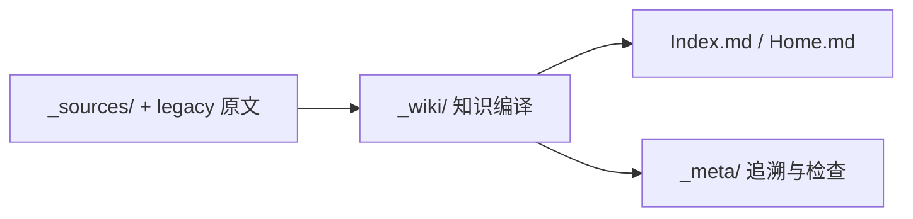

# Wei-Book

> 个人知识库：博弈论、系统思维、历史战略、哲学比较与决策科学。以 [llm-wiki-maintainer](https://github.com/XiaoWeiKIN/oh-my-skill/tree/main/skills/llm-wiki-maintainer) 的 **来源 → 编译知识 → 持续维护** 工作流组织内容。

## 从这里开始

**[Wiki 知识地图](_wiki/Home.md)** · [完整索引](Index.md) · [迁移覆盖矩阵](_meta/migration-plan.md) · [维护规范](AGENTS.md)

- **`_sources/`**：新摄取的原文、对话与其他可追溯证据。已归档的对话节选会标注完整性。
- **`_wiki/`**：综合过的概念、问题、比较与判断，包含来源、关联知识和适用边界。
- **`_meta/`**：来源映射、审阅记录、校验报告及后续更新。
- **`game-theory/` 和 `systems-thinking/`**：保留的原始笔记（legacy）。它们的历史引用路径不变，其中早期错误结论以新版 Wiki 页面为准。
- **`presentations/` 和 `templates/`**：演示文稿/办公附件与写作模板；不属于待编译的知识笔记，继续保留原用途。

## 当前已编译专题

| 分类 | 知识页面 | 重点 |
| --- | --- | --- |
| 博弈论 | [蜈蚣博弈](_wiki/GameTheory/蜈蚣博弈.md) | 逆向归纳、收益矩阵一致性与实验 |
| 博弈论 | [格罗斯曼—斯蒂格利茨悖论](_wiki/GameTheory/格罗斯曼-斯蒂格利茨悖论.md) | 信息成本和价格效率 |
| 博弈论 | [博傻与凯恩斯选美博弈](_wiki/GameTheory/博傻与凯恩斯选美博弈.md) | 转售预期和高阶信念 |
| 决策科学 | [效用与投机决策](_wiki/GameTheory/效用与投机决策.md) | 购买目的、风险与退出 |
| 系统思维 | [反身性与反馈回路](_wiki/SystemsThinking/反身性与反馈回路.md) | 认知、行为与现实的双向反馈 |
| 系统思维 | [命运与受约束能动性](_wiki/SystemsThinking/命运与受约束能动性.md) | 状态转移、路径依赖与可改变的条件 |
| 系统思维 | [控制边界与最小必要干预](_wiki/SystemsThinking/控制边界与最小必要干预.md) | 行动边界、BAFL、反馈与杠杆点 |
| 系统思维 | [胜利后的战略转型](_wiki/SystemsThinking/胜利后的战略转型.md) | 主要问题转换与战略适应 |
| 历史 | [秦统一与秦朝速亡](_wiki/History/Questions/秦统一与秦朝速亡.md) | 六国联盟、秦制与治理 |
| 哲学比较 | [缘起无为与控制哲学比较](_wiki/Philosophy/缘起无为与控制哲学比较.md) | 佛道与斯多葛的异同及类比边界 |

**这些是综合知识页，不是原著或论文的替代品。** 每篇记录直接来源或 legacy 引用，未经充分验证的历史轶事和跨学科断言均应明确标记，不得在后续复用中当作已确立事实。

## 原始笔记与存量内容

- [博弈论原稿目录](game-theory/)：5 篇 main 原有笔记，全部已映射到至少一个 Wiki 页面。
- [系统思维原稿目录](systems-thinking/)：4 篇 main 原有笔记 + 1 篇本 PR 第一阶段新增的秦史讨论稿，全部已映射到 Wiki。
- [演示文稿](presentations/) · [笔记模板](templates/)：维持原文件，不做知识页迁移。

## 维护工作流

1. 读取 `Index.md`、`_wiki/Home.md` 以及最近的相应知识页，优先更新现有页，避免重复建页。
2. 将新资料保存到 `_sources/inbox/YYYY-MM/`，使用 canonical Skill 的 `wiki_ingest.py plan` 生成带哈希的摄取计划。
3. 提取 3–7 条持久主张，更新全部受影响页面，引用 source 和原文路径，补齐索引后运行 `process`。
4. 分别运行 `wiki_lint.py --profile wiki` 与 `--profile sources`，并记录结果。若无法执行脚本，应明确报告静态替代验证范围。
5. 对存在争议、敏感来源、破坏性迁移或影响超过三张 durable 页的更改进行人工 PR 审阅。

规范详情参见 [AGENTS.md](AGENTS.md)，变更记录见 [_meta/log.md](_meta/log.md)。

## 使用说明

该仓库收录学习笔记、观点及重构后的知识综合，不构成个人投资建议，也不表示原始资料中的全部叙述均经学术同行评议。
