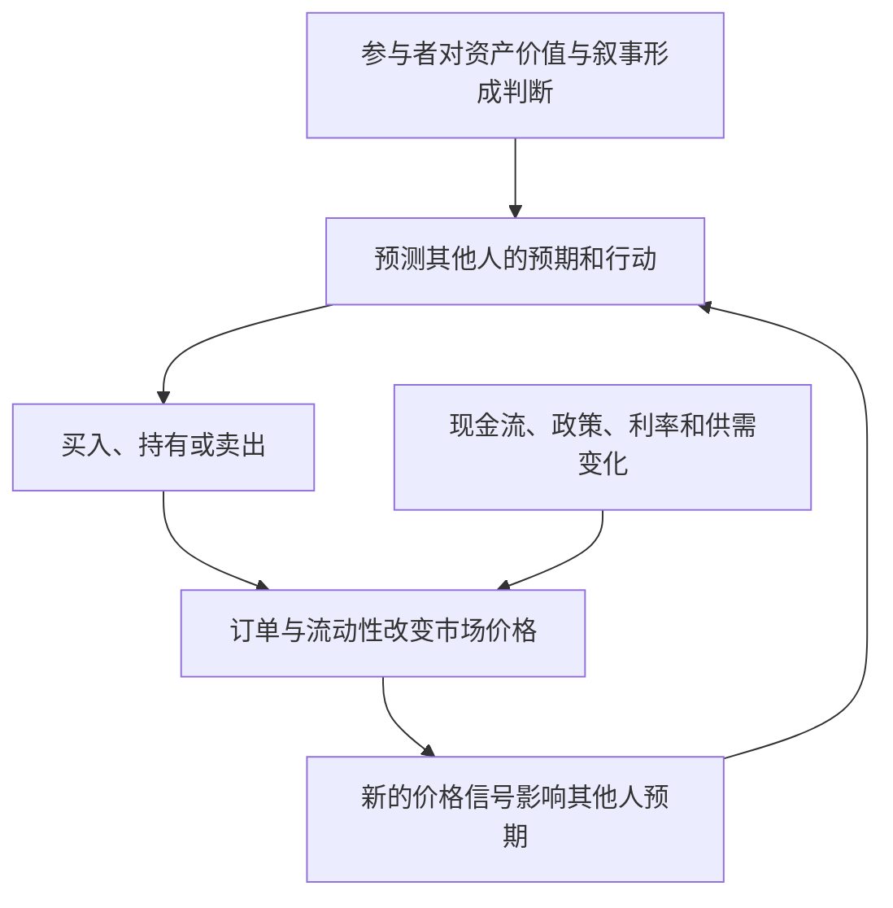

# 博傻与凯恩斯选美博弈：价格预期中的高阶信念

## 定义

**博傻（Greater Fool）**是一种交易动机：买方主要期望未来有人以更高价格接盘，而非仅依据现金流、使用价值或可验证的盈利预期作判断。它是对参与者动机的描述，**不是证明所有高估值交易都必然非理性的定理**。

**凯恩斯选美博弈**来自《就业、利息和货币通论》第12章：参加者不是选自己认为最美的面孔，而是预测其他人会选什么，甚至预测他人对大众判断的判断。它解释的是**高阶信念**（beliefs about beliefs），而不只是在寻找“更傻的人”。

## 机制：为什么大家都在预测其他人的预测？



可用一个教学表达式区别两种动机：

```text
持有的预期回报 ≈ 未来现金流与终值 + 未来转售价格的变化 − 交易和融资成本 − 风险损失
```

如果交易理由主要落在“预期他人愿意出更高价格”，就是博傻动机的典型特征。但交易者同时也可能基于风险对冲、流动性需要或估值分歧操作，不能以单一动机解释整个市场。

## 与相近机制的区别

| 机制 | 关注点 | 不能直接推导出什么 |
| --- | --- | --- |
| 博傻 | 未来转售给更高出价者 | 所有涨价必然是泡沫 |
| 凯恩斯选美 | 对别人预期的预期 | 别人一定非理性 |
| [[_wiki/SystemsThinking/反身性与反馈回路\|反身性]] | 预期/交易能否改变基本面 | 任意价格波动都会引起基本面变化 |
| [[_wiki/GameTheory/格罗斯曼-斯蒂格利茨悖论\|信息效率悖论]] | 搜集信息的成本与价格的信息含量 | 套利消灭市场 |

**例子**：一家公司股价上涨，但并未改变融资、业务和现金流，买方仅相信未来还会有人给出更高报价——更接近转售预期。如果股价上涨让其股权融资成本下降，进而推动投资扩张和经营改善，则还涉及反身性反馈。

## 事实与轶事的证据边界

旧笔记使用“荷兰郁金香球茎抵一栋豪宅”“全国崩盘九成”“牛顿曾说无法计算人性疯狂”等广泛传播的故事。这些叙述**不可直接当作经过严格核实的交易记录或逐字引语**。尤其郁金香狂热的规模与社会影响，Anne Goldgar 的档案研究对传统流行叙事提出了实质修正。

因此这里不沿用那些具体百分比、价格和人物语录。研究泡沫需分开检验：交易记录、合约制度、参与者样本、价格走势与后世故事。

## 使用方法

面对快速上涨的资产，先问：

1. 价格的主要支撑来自可验证现金流、实用需求，还是下一位买家的出价？
2. 我的判断是否依赖对大众预期的二阶、三阶猜测？
3. 流动性降低、利率变化或叙事反转时，退出假设还成立吗？
4. 是否存在价格改变基本面的反身性渠道，还是只有交易价格自我强化？

## 资料与证据

- [原有博傻理论笔记（legacy）](../../game-theory/greater-fool-theory.md)：历史素材；含未核实的郁金香、牛顿和价格轶事，原文保留未覆盖。
- John Maynard Keynes, *The General Theory of Employment, Interest and Money* (1936), Ch. 12: [“The State of Long-Term Expectation”](https://www.hetwebsite.net/het/texts/keynes/gt/chap12.htm)。
- Anne Goldgar, *Tulipmania: Money, Honor, and Knowledge in the Dutch Golden Age* (2007), [University of Chicago Press](https://press.uchicago.edu/ucp/books/book/chicago/T/bo5414939.html)：档案研究修正了普遍流传的郁金香故事。
- [Oxford Faculty of History: Tulipmania](https://www.history.ox.ac.uk/tulipmania-garden-historians-perspective)：讨论早期讽刺传单与后世叙事的证据限制。
- [[_wiki/SystemsThinking/反身性与反馈回路\|反身性与反馈回路]]：价格通过融资和行为影响基本面的独立机制。

## 待复核

- 在需要写金融史专题时，分别核实南海泡沫、互联网泡沫的价格指标和原始数据，避免把类比误写为精确历史统计。
