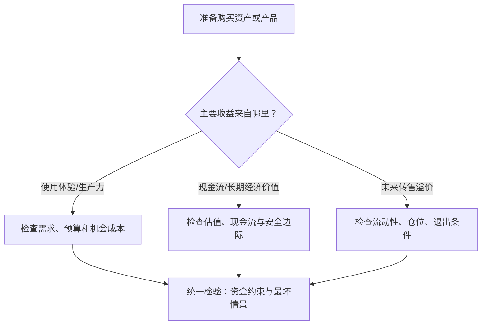

# 效用与投机决策：区分购买目的与管理风险

## 结论

**先明确一项购买主要为了使用、获取现金流，还是押注未来转售价，再匹配不同的预算与风险规则。** 这是一个有用的自检框架，而不是“所有投资必须硬止损”的普遍理论。

购买动机可能混合：住房既有居住效用，也有长期财务风险；股票可能兼具现金流预期与短期价格预期。不能强制把所有购买归入“纯消费”或“纯投机”。

## 决策树

## 对比维度

| 维度 | 消费/使用 | 长期投资 | 短期投机 |
| --- | --- | --- | --- |
| 核心收益 | 使用体验、时间节省、生产效率 | 现金流与长期经济价值 | 价格变动带来的收益 |
| 首要评估 | 真实需求、可负担性 | 估值、商业质量、资金期限 | 流动性、风险暴露、策略有效性 |
| 退出方式 | 转卖不一定必要 | 再平衡、估值变化、基本面恶化 | 止损/止盈/时间退出/风险预算 |
| 常见偏误 | “保值”叙事导致超预算 | 价格波动被误认成永久损失或机会 | 追涨、沉没成本、损失厌恶 |
| 重要限制 | 使用效用也会变化 | “基本面”可能被误判 | 硬止损可能遭遇滑点和假突破 |

## 三个需要纠正的旧结论

**一、使用价值并不意味着“价格暴跌也毫无损失”。** 净资产、偿债能力、换房/迁移灵活性和替代购买机会可能因价格变化而受影响。使用效用与市场价值应分开衡量，不能让前者抹去后者。

**二、投机失败不一定是“价格一跌就被证伪”。** 要求定义进入假设、观察窗口和失效条件。趋势跟随策略可以使用止损，套利、对冲或长期持有策略可能采用别的风险控制；即使设置止损，也存在跳空、滑点与流动性风险。

**三、前景理论并不意味着所有人亏损时必然更偏好风险。** Kahneman 和 Tversky 的研究描述在特定选择框架下的常见偏好模式，不能推断个体在任何市场场景都会如此。

## 把规则落到纸面

- **预算**：最坏可承受损失、负债约束、流动性需求与资金期限。
- **理由**：使用收益、现金流假设、市场预期分别写清，不在亏损后偷偷更换论证。
- **退出**：预设可观测的失效信号、仓位上限和复盘期限；止损价仅是一种实现。
- **复盘**：检验当时的决策过程，而不是以事后的市场涨跌单独评价质量。

**示例**：购车时先计算使用年限、保养、保险和资金成本；转卖残值属于成本项，不应混淆成使用体验。投资时把估值假设与现金流来源分离。以上是分析框架，非个性化交易建议。

## 关联概念

- [[_wiki/GameTheory/博傻与凯恩斯选美博弈\|博傻与选美博弈]]：买入理由建立在未来转售价格时，需要特别警惕高阶预期链。
- [[_wiki/SystemsThinking/反身性与反馈回路\|反身性与反馈回路]]：市场价格可能反过来影响融资和基本面。
- [[_wiki/GameTheory/格罗斯曼-斯蒂格利茨悖论\|信息效率悖论]]：价格的信息含量与获取信息成本。

## 资料与证据

- [旧版“效用认知与投机风控准则”（legacy）](../../game-theory/utility-vs-speculation.md)：保留原始观点，部分绝对化措辞在本页修正。
- Daniel Kahneman & Amos Tversky, [“Prospect Theory: An Analysis of Decision under Risk”](https://ideas.repec.org/a/ecm/emetrp/v47y1979i2p263-91.html), *Econometrica* 47(2), 1979, pp.263–291。
- 本页的决策树是基于旧笔记和风险预算理念的综合建议，并非原论文的实验结论。

## 待更新

- 可根据不同资产与期限补充风险预算、再平衡和退出策略的定量例子；避免给不同风险结构套用同一止损比例。
