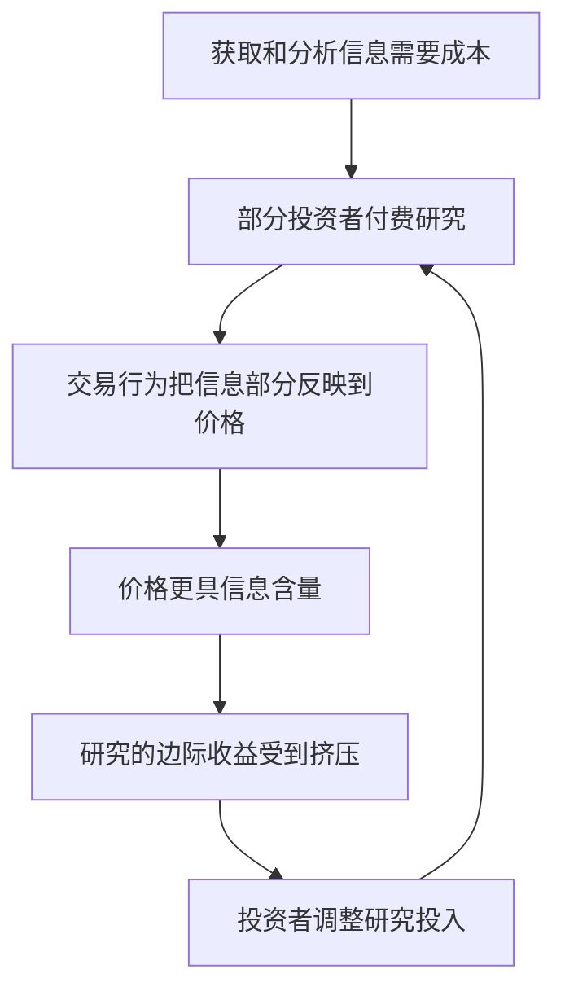

# 格罗斯曼—斯蒂格利茨悖论：为什么价格不能完全反映有成本的信息？

## 定义与核心判断

**格罗斯曼—斯蒂格利茨悖论（Grossman–Stiglitz paradox）**讨论的是一个信息生产的激励问题：如果获取信息有成本，而市场价格已经完全揭示这些信息，那么支付成本获取信息的投资者将难以获得相应回报。若所有投资者都因此不愿生产信息，价格又如何持续反映那些信息？

该悖论指向**完全信息效率与有成本的信息获取之间的张力**，并不证明“市场必须消亡”或“无人能够持续获得超额收益”。

## 机制：价格效率需要有人付出信息成本



在经典模型的条件下，均衡中的价格一般不可能完全揭示所有有成本获取的私人信息，否则信息生产者没有足够激励持续承担信息成本。模型通过知情与不知情投资者、信息成本及噪声等要素讨论价格的信息含量和研究激励如何共同决定。

可以用一个**示意性的净收益表达式**说明激励，而不是将它误当作原论文完整均衡方程：

```text
信息研究的净收益 = 信息优势带来的预期收益 − 获取与处理信息的成本
```

当价格已充分吸收某项研究发现时，该项研究的新增交易价值通常下降。均衡要求有人仍愿意研究，并不要求每个研究者都稳定盈利。

## 必须区分的四个命题

| 命题 | 是否由该悖论直接支持 | 理由 |
| --- | --- | --- |
| 有成本的信息获取与完全揭示价格之间存在激励冲突 | 是，在模型假设下 | 信息获取者需要补偿研究成本 |
| 市场价格可能高度有效，但并非完美反映所有私人信息 | 与模型一致 | 效率是程度问题，不是非黑即白 |
| 任何能够长期战胜市场的策略最终都会导致市场消亡 | **否** | 策略容量、竞争和价格调整不等于交易体系必然消失 |
| 交易必须来自买卖双方对“真实价值”的意见分歧 | **否** | 流动性、再平衡、风险转移和期限需求也能促成交易 |

## 与无套利、有效市场假说和反身性的关系

- **有效市场假说（EMH）**关注价格反映信息的程度，以及由此产生的可预测超额收益机会。格罗斯曼—斯蒂格利茨提出了信息获取激励与完全效率的张力，不能把“信息效率”直接等同于“所有信息在任何时点完全公开”。
- **无套利**是资产定价的重要约束，但不意味着所有预测优势都属于无风险套利；信息优势交易通常承担风险与成本。
- **竞争侵蚀策略收益**是合理的市场机制：研究成果被交易吸收、竞争者模仿、交易冲击和容量限制可能削弱优势。不过，这个机制不能单独推出“市场整体崩溃”。
- **反身性**强调市场参与者的预期与行为会影响现实和价格，是不同的问题；二者可以并列分析，但不能视为同一个定理。

## 原有笔记的三处需要修正的推论

1. 原文将“信息获取激励悖论”延伸为“永远正确的交易者必使所有交易对手消失”。现实交易存在非信息动机，逻辑上不成立。
2. 原文推断套利资本将无限集中，最终由“中央超级计算机统一分配”。这不是格罗斯曼—斯蒂格利茨模型的结论，缺乏相应前提。
3. 原文将“超额收益被竞争压缩”写成“自由交易市场必然灭亡”。收益收敛和市场消亡是不同命题，不能混同。

这些原文观点作为历史讨论材料保留在 legacy 文件中，不进入本页的已确立结论。

## 工程与决策映射

可将“信息生产—信息扩散—边际价值衰减”理解为一种激励反馈：若某个系统的知识生产需要成本，而结果被完全免费共享，则需要重新设计贡献激励；否则知识供给可能不足。但市场均衡模型与开源软件、内部知识库并不完全同构，类比只用于提出问题。

进一步的问题是：系统希望达到的目标究竟是**消除信息差**，还是**让信息发现与传播的成本被合理分担**？

## 资料与证据

- [原有笔记（legacy，未覆盖）](../../game-theory/grossman-stiglitz-paradox.md)：保留旧论证与可追溯的待修正推论。
- Sanford J. Grossman and Joseph E. Stiglitz, “On the Impossibility of Informationally Efficient Markets,” *American Economic Review*, 70(3), 1980, pp. 393–408。**原始理论来源**；模型假设和推导以论文为准。
- Eugene F. Fama, “Efficient Capital Markets: A Review of Theory and Empirical Work,” *Journal of Finance*, 25(2), 1970, pp. 383–417。**相关理论背景**，并非对 Grossman–Stiglitz 的直接证明。

## 待验证

- 逐项核对原论文的知情交易者、噪声与信息成本设定及比较静态结论。
- 补充“信息生产激励”与实际金融市场信息价格发现的经验研究，避免把理论模型直接当成实证定律。
