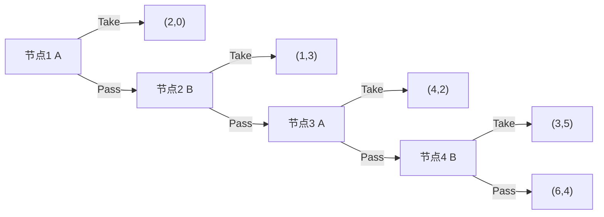

# 蜈蚣博弈：为什么理性倒推可能使合作提前终止？

## 定义

蜈蚣博弈（Centipede Game）是一个有限期、轮流行动的动态博弈。每轮当前行动者可选择 **Take（终止）** 或 **Pass（继续）**。继续通常扩大双方可分配的总收益，但改变下一轮的控制权。

它用来研究**逆向归纳法、共同知识、合作与策略理性之间的关系**。不能把“所有蜈蚣博弈都第一轮终止”当作无条件结论；必须先检查具体收益设定。

## 一个自洽的四轮示例

下表为教学构造的收益（A、B），不是对某篇实验论文数据的复刻。

| 决策节点 | 行动者 | 此时 Take 的收益 (A,B) | Pass 后 |
| --- | --- | --- | --- |
| 1 | A | (2,0) | 进入节点 2 |
| 2 | B | (1,3) | 进入节点 3 |
| 3 | A | (4,2) | 进入节点 4 |
| 4 | B | (3,5) | 终局 (6,4) |

这个示例保证最后节点 B 在 Take 时得 5，在 Pass 时得 4，因此 B 会选择 Take。依次向前倒推：

1. **节点 4**：B 比较 5 与 4，选 Take。
2. **节点 3**：A 知道下一轮 B 会 Take，比较立即 Take 得 4 与继续后得 3，选 Take。
3. **节点 2**：B 知道下一轮 A 会 Take，比较立即 Take 得 3 与继续后得 2，选 Take。
4. **节点 1**：A 知道下一轮 B 会 Take，比较立即 Take 得 2 与继续后得 1，选 Take。

在**收益表固定、玩家在每个节点最大化自身收益且理性为共同知识**等条件下，这个示例经逆向归纳得到首轮 Take 的子博弈精炼均衡路径。

**注意：如果将最后的 Pass 收益改为 (6,6)，则 B 在节点 4 更愿意 Pass；前述逆向归纳链条立即失效。** 这正是旧笔记的问题，不能用一句“标准模型通常如此”跳过收益比较。

## 理论结论与实验现象

标准教学模型经常得到首轮终止的逆向归纳预测；但真实参与者在实验中通常会继续若干轮。McKelvey 与 Palfrey（1992）研究了蜈蚣博弈中的行为偏离，并提出解释。不同实验的收益表、轮数、参与者和结果分布各异，**不能不核对原始实验数据就宣称“通常进行到 70%—90%”**。

潜在解释包括：对他人理性的信念并非共同知识、互惠偏好、有限理性、风险态度和实验条件差异。这些机制应当作为可检验假说，而不是对所有参与者行为的唯一解释。

## 与相近概念的区别

| 概念 | 区别 |
| --- | --- |
| 逆向归纳法 | 从终局往前求解有限动态博弈的决策程序 |
| 子博弈精炼均衡 | 要求每个子博弈中策略构成纳什均衡的解概念 |
| 囚徒困境 | 常见模型为同时行动；蜈蚣博弈是序贯行动 |
| 重复博弈 | 一次基础博弈反复进行；蜈蚣博弈内部本身就包含多个决策节点 |
| 可信承诺 | 解释为什么合作的口头意愿不必然改变理性预期 |

## 使用场景与边界

可用于分析分阶段合作、逐步交付、长期交易中“提前退出”与“继续合作”的激励。现实合同存在声誉、违约赔偿、外部选项和不完全信息，不能不建模就将现实交易直接等同于蜈蚣博弈。

工程类比：如果分期项目在最终阶段存在不履约激励，应该改变终局支付、违约责任或声誉成本，而不是仅要求参与者“更信任彼此”。这属于模型启发，不代表每个合同都符合蜈蚣博弈结构。

## 资料与证据

- [Wei-Book 原始蜈蚣博弈笔记（legacy）](../../game-theory/centipede-game.md)：保留原文以追踪旧模型错误；旧文最后节点 B 的收益比较不成立。
- Robert W. Rosenthal (1981), “Games of Perfect Information, Predatory Pricing and the Chain-Store Paradox,” *Journal of Economic Theory* 25(1): 92–100。
- Richard D. McKelvey and Thomas R. Palfrey (1992), “An Experimental Study of the Centipede Game,” *Econometrica* 60(4): 803–836。
- [秦统一与秦朝速亡](../History/Questions/秦统一与秦朝速亡.md)：联盟承诺问题的历史类比，但其战略结构与蜈蚣博弈不相同。

## 待核对

- 按 McKelvey 与 Palfrey 原始论文中的不同实验条件复核实际终止轮次与分布。
- 将不同的收益矩阵形式与其子博弈精炼均衡逐一验证。
