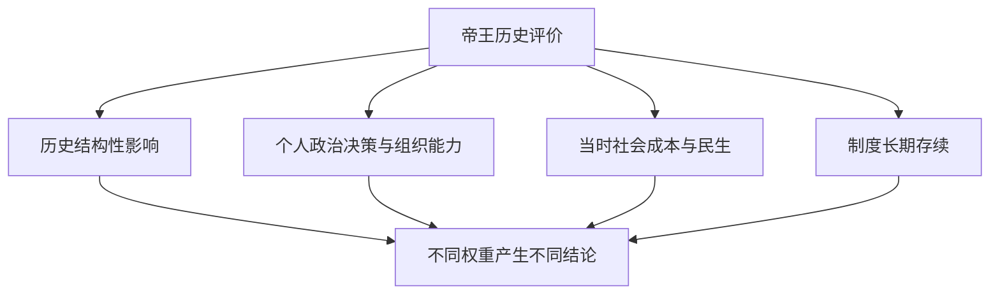
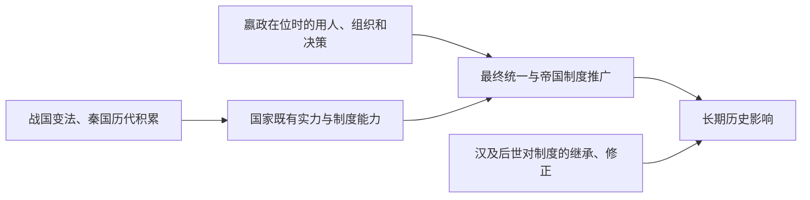

# 秦始皇的历史功绩与地位：应该如何与历代帝王比较？

## 结论

秦始皇的历史分量主要来自**公元前221年完成六国统一、建立皇帝政权，以及将战国形成的行政与标准化制度推广至统一帝国**。这些举措成为后世王朝继承、修正和重建统一国家时的重要制度资源。

但是，**影响深远、个人能力强、治理效果好、社会代价小**是不同维度，不能直接换算成一个客观的帝王名次。只问“排第几”，容易把国家制度的奠基、战争胜负、民生表现与王朝持续时间混成同一指标。

本页专门保留对话中的两个核心问题：“从历史地位来看怎么样？”以及“是否能与其他重要帝王比较、排序？”结论来自历史事实与明确的评价标准，不使用无法证实的绝对名次。

## 一、评价框架：哪些贡献应当单独计量？

| 评价维度 | 秦始皇的历史表现 | 评价限制 |
| --- | --- | --- |
| 政治整合 | 消灭六国独立政权，建立覆盖原六国地区的皇帝政权 | 战国长期兼并和秦历代扩张已经奠基 |
| 制度形成 | 皇帝制度、中央官僚和全国郡县行政进一步整合 | 郡县制、官僚化及部分标准化措施并非始皇独创 |
| 经济与文化整合 | 文字书写规范、度量衡与币制等标准化政策 | 具体执行地域、速度和社会影响需分别研究 |
| 大规模组织能力 | 征服战争、交通设施与行政推广 | 高强度动员带来劳役、财政和社会负担 |
| 王朝可持续性 | 秦朝迅速灭亡，但部分制度为汉所继承 | “制度遗产长久”不能掩盖“秦统治短暂” |
| 社会治理与合法性 | 创设统一帝国的政治表达，同时面临广泛反抗 | 官民关系、刑罚与征发须同时讨论，不应用统一成就抹消代价 |

**制度首创、制度普及与制度长期存续是三件事**。例如郡县及官僚行政在战国已有发展；秦的特殊影响是将其中的重要制度在统一帝国尺度实施；汉又作出修正和继承。

## 二、和其他重要帝王比较，究竟比较什么？

以下是**贡献类型对照，不是名次排序**：

| 历史人物 | 与秦始皇可比的主要贡献类型 | 不宜混淆的评价对象 |
| --- | --- | --- |
| 秦始皇 | 由竞争的诸侯政权建立统一皇帝政权；整合全国制度 | 制度转折的广度及其统治成本 |
| 汉高祖刘邦 | 在秦亡后重新建立大范围王朝并调整秦遗产 | 创业整合、对既有秦制的继承与妥协 |
| 汉武帝 | 在既有汉朝体制上强化中央权力，扩张军事与外交影响 | 帝国扩张及国家动员的财政代价 |
| 唐太宗 | 唐初政治整合、官僚运行与对外关系 | 既有王朝的治理和制度实施 |
| 宋太祖 | 五代政治格局下的统一进程与中央军事控制调整 | 王朝军政制度重组与对后世的影响 |

例如，若**评价问题限定为“中国统一皇帝制度的建立”**，秦始皇便是绕不开的历史人物；若问题是**在位时期社会安定、官僚反馈和后继稳定**，评价方法就需要引入其他证据，不能沿用前一个答案。

## 三、历史地位最值得追问的两种贡献

**第一种是完成政治统一。** 公元前230至前221年的一系列战争使七雄政治体系结束。但应明确，秦统一的军事实力部分来自商鞅变法、巴蜀资源和历代征伐，不意味着嬴政一人从弱国起家。

**第二种是统一之后留下的制度参照。** 汉初并未把秦的行政、书写和统治组织整体推倒重来，而是在相当程度上继承与调整。这使“秦朝十四年左右即崩溃”与“秦制对后世影响长久”可以同时成立。

《史记》收录的《过秦论》强调兼并与守成所需策略不同；它是后人对秦亡的政治解释，不应视为秦始皇亲自提出的统治理论。

## 四、个人贡献与国家积累为什么要分开？

这一模型提示：不能把数代积累全部记在一个人名下，也不能因为秦最终趋强就说“任何君主必定能在同一时间统一”。两个反事实结论都缺少可验证依据。

## 五、适用条件与风险

- 本页讨论的是**评价框架**，不提供所有帝王的单一数字排名；不同价值指标无法自然合并为唯一名次。
- 说历史影响深远，不等于对征发、刑罚、思想控制等政策作道德豁免。
- “中国两千年大一统全部由秦始皇一人决定”属于过度归因；汉及后世王朝的选择也是独立变量。
- 与罗马等其他文明比较时，应采用相近的政治实体与阶段，不以现代欧洲边界衡量古代战国。详见 [[_wiki/History/Comparisons/秦汉与罗马帝国的比较|秦汉与罗马帝国的比较]]。

## 相关知识

- [[_wiki/History/People/秦始皇的个人政治能力|秦始皇的个人政治能力]]：亲政、用人、战略调整的证据和归因限制。
- [[_wiki/History/Questions/秦统一与秦朝速亡|秦统一与秦朝速亡]]：兼并战争、联盟博弈与王朝短命。
- [[_wiki/SystemsThinking/胜利后的战略转型|胜利后的战略转型]]：征服转向长期治理时的任务变化。

## 资料与证据

- [[_sources/conversations/2026-10/qin-unification-conversation|原对话精选来源]]：明确包含“从历史地位来看怎么样”的用户问题；并非逐字完整转录。
- [秦始皇的统一与治理转型（讨论初稿）](../../../systems-thinking/qin-unification-strategy-transition.md)：本系列前期综合材料。
- [《史记·秦始皇本纪》](https://ctext.org/shiji/qin-shi-huang-ben-ji)：秦初即位、征服与帝国政策的传统史料；须辨识其中诏令、自述和后人论赞。
- Yuri Pines, [“Institutional Reforms and Reformers during the Warring States Period”](https://cris.huji.ac.il/en/publications/institutional-reforms-and-reformers-during-the-warring-states-per/), *The Oxford Handbook of Early China* (2020)：秦改革与动员能力的长期背景。
- Yuri Pines et al. (eds.), [*Birth of an Empire: The State of Qin Revisited*](https://escholarship.org/uc/item/4h74v49p)：秦国家制度与汉继承问题的研究。
- Walter Scheidel (ed.), [*Rome and China*](https://academic.oup.com/book/47174) (2009)：跨文明比较的方法参照。

## 待研究

- 对某两位帝王做严格同维度比较，需要补充可核验的同时代财政、军事、人口和治理数据。
- 历代对秦始皇的评价受史书编纂时代与政治立场影响，后续可单独整理“评价史”。
