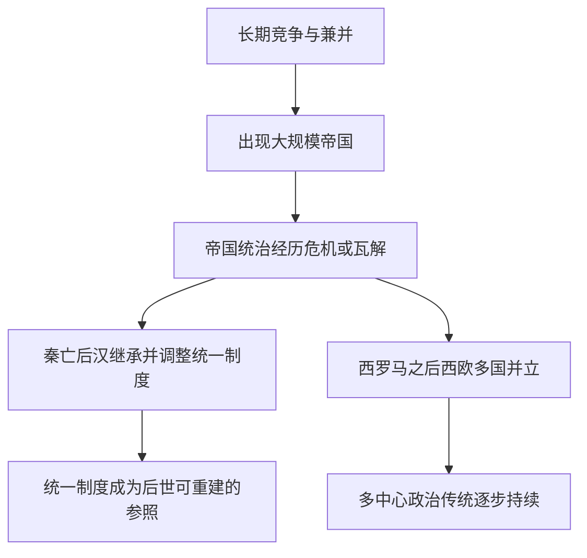
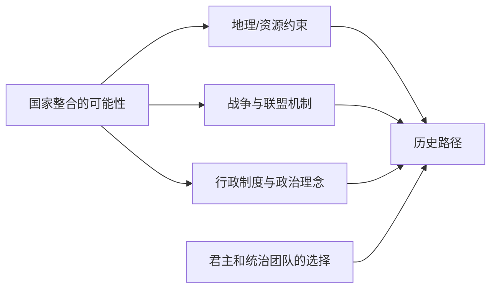

# 秦汉与罗马的比较：为什么中国反复统一，而欧洲长期多中心？

## 结论

“秦始皇统一六国，相当于欧洲两千年做不到的事”是一个**比较对象不对等**的说法。罗马曾建立横跨地中海的大型帝国；秦的对手是战国时期的六个独立政权，而“欧洲”是跨越两千多年、疆域与成员不断变化的现代地理和政治概念。

更有解释力的比较是：**古代秦汉与罗马都发展了大规模帝国，为什么西罗马瓦解后欧洲西部长期保持政治多中心，而中国在多次分裂后又出现全国性王朝？**

Walter Scheidel 主编的《Rome and China》把秦汉帝国与统一罗马帝国作比较：两者在规模和人口方面大体可比，但治理方式、地方精英作用及官僚化路径不尽相同。本页不据此认定某个文明“必然统一”。

## 一、先把比较对象调整正确

| 比较维度 | 秦汉帝国 | 罗马帝国 |
| --- | --- | --- |
| 形成背景 | 战国诸侯长期兼并，秦于前221年完成最后统一；汉延续并修正统一帝国 | 罗马在意大利与地中海世界长期扩张，最终建立横跨多个区域的帝国 |
| 空间核心 | 华北平原与相关农业、河流、交通网络 | 地中海沿岸及其海上运输网络 |
| 治理机制 | 秦汉高度发展郡县、户籍、文书与官僚行政 | 罗马借助城市、地方精英与不同层级的行政组织 |
| 后续政治 | 秦亡而汉继承部分秦制，历史上出现数次分裂和再统一 | 西罗马政权瓦解；东罗马持续存在，西欧出现多个王国与政治中心 |
| 历史遗产 | 统一帝国及中央—地方行政成为长期政治参照 | 罗马法律、城市、基督教与帝国象征在后世以不同形式延续 |

时间须保持一致：不能把“公元前221年的秦统一”与“现代欧洲从未出现单一国家”作为直接同类指标。比较史研究强调的是**古代国家形成、帝国分裂和制度延续**。

## 二、为何秦汉出现统一帝国，而罗马也曾形成帝国？

从国家形成看，双方具有共同条件：中心国家能够长期动员军事、政治与经济资源，对周围政治体进行征服和整合。秦国与罗马不是一出生就占有如此庞大的疆域。

但**形成帝国**与**维持帝国**是两个不同的分析问题。汉朝对秦制的继承与妥协，以及罗马不同地区对帝国权力的整合方式，都是扩张后必须考察的制度变量。

这是一张解释框架图，不表示秦汉历史没有长期分裂，也不意味着欧洲没有大型帝国及复兴统一的尝试。

## 三、为什么后来的历史轨迹分化？

现有研究提出多个互相作用的机制：

1. **地理与连通性**：华北平原、黄河流域和后来的南北交通有助于整合；欧洲的半岛、山脉与区域经济核心更分散。但地理不能单独决定结果，罗马的存在本身就是反例。
2. **帝国制度的路径依赖**：秦汉的中央行政、统一文字和政治合法性主张成为后世重要参照；西罗马瓦解后，西欧不同王国和地方精英形成竞争格局。
3. **军事压力与联盟结构**：草原方向安全、边疆压力与诸侯/地方军政结构影响国家集中或分裂的成本。不同朝代存在变化，不能用一个常数解释两千年。
4. **政治竞争的激励**：多中心欧洲维持较多独立政治选择，统一王朝则有组织大型公共工程、维持跨区秩序的机会；两者都可能出现战乱和控制成本。
5. **历史偶然与继承者决策**：秦始皇只是早期统一的关键行动者；汉、隋、唐及其他王朝的选择都在塑造后世格局。

Walter Scheidel 在 *Escape from Rome* 中强调罗马覆灭之后欧洲持续的政治分散与制度竞争。Mark Koyama 的同行评议论文专门检视该理论及其反事实推演。**这是学术解释与争论，不是“欧洲因为分裂所以一定更先进”的已证实定律。**

## 四、个人伟大与文明长期走势不能划等号

把“欧洲没有持续的大一统”归因为“欧洲统治者都不如秦始皇”，忽视了各政治体所在的地理、资源与制度条件。同样，把后世中国的每次统一都计入秦始皇个人功绩，也忽视了汉和后世王朝的主体行动。

可以区分三类问题：

| 问题 | 合适的分析方式 |
| --- | --- |
| 秦始皇面对六国战争有多困难？ | 比较战国后期的国家实力、军事、外交、联盟与补给 |
| 秦始皇的长期历史功绩是什么？ | 考察统一国家框架、制度推广及其后世继承 |
| 中国与欧洲为何形成不同国家体系？ | 比较古代帝国形成、崩溃、制度遗产及政治竞争结构 |

## 五、反事实：如果秦始皇没统一，中国会成为欧洲吗？

至少有三类路径：其他诸侯最终实现统一、出现较长期多国均势、统一与分裂反复交替。它们都需要说明各国之间的军政实力、联盟承诺和制度变动，而不能凭“地理决定一切”或“个人能力决定一切”作出必然预测。

**一个历史问题的反事实价值在于揭示哪些条件对结果重要，而不是为没有发生过的历史提供确定名次或精确概率。**

## 关联知识

- [[_wiki/History/Comparisons/秦始皇的历史功绩与帝王比较|秦始皇的历史地位与功绩]]：区分制度奠基与后世历史发展的贡献归属。
- [[_wiki/History/People/秦始皇的个人政治能力|秦始皇的个人政治能力]]：为何不能把文明路径直接归因于个人能力。
- [[_wiki/History/Questions/秦统一与秦朝速亡|秦统一与秦朝速亡]]：战国联盟博弈及秦亡。
- [[_wiki/SystemsThinking/胜利后的战略转型|胜利后的战略转型]]：征服与守成任务切换的现代分析视角。

## 资料与证据

- [[_sources/conversations/2026-10/qin-unification-conversation|原始讨论节选]]：包括“有人把统一6国对比欧洲”的用户提问；不是完整对话或比较史的一手材料。
- Walter Scheidel (ed.), [*Rome and China: Comparative Perspectives on Ancient World Empires*](https://academic.oup.com/book/47174), Oxford University Press, 2009：古代两大帝国国家形成与制度差异。
- Walter Scheidel (ed.), [*State Power in Ancient China and Rome*](https://classics.stanford.edu/publications/state-power-ancient-china-and-rome), Oxford University Press, 2015：统治精英、官僚制、政府组织与地方城市比较。
- Walter Scheidel, [*Escape from Rome*](https://history.stanford.edu/publications/escape-rome-failure-empire-and-road-prosperity), Princeton University Press, 2019：罗马瓦解后的欧洲政治分散论。
- Mark Koyama, [“Counterfactuals, Empires, and Institutions: Reflections on Walter Scheidel’s Escape from Rome”](https://pubs.aeaweb.org/doi/10.1257/jel.20201601), *Journal of Economic Literature*, 2021：对上述解释的评述。
- Yuri Pines et al. (eds.), [*Birth of an Empire: The State of Qin Revisited*](https://escholarship.org/uc/item/4h74v49p)：秦帝国建制及汉代继承研究。

## 待考证

- 在固定空间范围和相似时间段下比较双方人口、领土和税收动员水平。
- 具体分析罗马行省与秦汉郡县的管理差异，避免将任何一方描述为没有官僚制度。
- 对“欧洲多中心直接推动现代科学/工业革命”的解释与替代理论进行区分研究。
