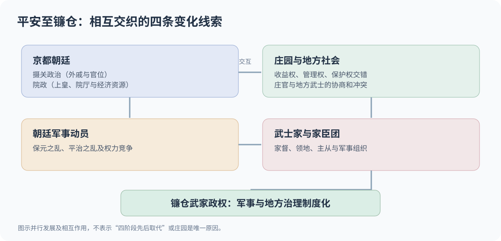

# 公家、武家与幕府：平安时代的权力如何转向地方武士？

## 核心判断

**公家依托京都朝廷的官位、家格和礼制网络；武家依托具体家名、家臣与军事资源组织权力。两者并非始终互斥的文官与军官阶级。** 从平安到镰仓的关键变化，是武士从为朝廷与地方权利人服务的军事集团，逐步建立了可持续的军事、司法与地方治理制度。

## 公家与武家的制度对照

| 维度 | 公家（くげ） | 武家（ぶけ） |
| --- | --- | --- |
| 核心组织 | 朝廷贵族之家、摄关家、官位与家格 | 武士家、家督、领地与家臣团 |
| 权力载体 | 官职、婚姻、仪礼、经济权益 | 军事实力、主从关系、土地权益与治理机构 |
| 代表家名 | 近卫、九条、一条 | 源氏各武家分支、足利、新田、德川 |
| 典型角色 | 摄政、关白、公卿 | 将军、御家人、守护、地头 |
| 交叉区域 | 公家家族可有武装与土地权益 | 武家可以受任朝廷官位，依靠朝廷名分 |

这里的公家／武家是理解中世政治的类型划分，而不是从奈良时代就完整存在的一套二元行政组织。德川家康既是武家领袖，也受朝廷授官；平清盛以军事权力崛起，却参与京都朝廷政治并任太政大臣。

## 权力转型的四个交织过程

### 1. 摄关政治：藤原氏控制朝廷的关键环节

平安中期，藤原北家通过与天皇家联姻、让外孙即位，并长期掌握摄政、关白等职位，形成显著的中央政治优势。摄政和关白的职能并非简单等同于「替代天皇」，而是参与对在位天皇与朝廷的政务控制。

### 2. 院政：上皇成为朝廷中的另一个权力中心

1086 年，白河天皇退位，退位天皇通过院厅、院司、庄园资源及宫廷关系继续影响政务。院政削弱了特定摄关家的独占影响，却没有消灭公家政治，也没有将权力直接交给武士。

[Cambridge History of Japan · Insei](https://www.cambridge.org/core/books/abs/cambridge-history-of-japan/insei/EFB19CC1DE848D93FE5675A389476A13) 概括了白河、鸟羽、后白河院政及上皇对省厅和地方庄园的管理。

### 3. 庄园：收益权、管理权与实际控制分离

庄园不是一块土地只属于一个地主的现代产权关系。一个庄园的收益、管理、行政豁免和武力保护等权益，可能分布在本家、领家、庄官及地方势力之间；镰仓时代又有地头等幕府任命的地方管理者参与。

**关键机制**不是「公家把所有土地交给武士」，而是多层土地权利与实际执行能力逐渐分化，地方武士因此获得更大政治谈判力量。庄园制度从早期就与摄关政治、院政交错发展，不能误画成院政结束后才出现。

### 4. 武家：从军事动员到独立治理

地方武士依托血缘、家名、土地权益和主从网络形成军事集团。1156 年保元之乱、1159—1160 年平治之乱反映了朝廷政治冲突对军事力量的依赖。平氏通过朝廷政治获取优势，源赖朝则在镰仓发展武家政权。

*图：《平治物语绘卷·六波罗行幸卷》局部，描绘 1159—1160 年平治之乱相关故事，为镰仓时代绘画叙事而非事件现场记录；[Wikimedia Commons 原图和公有领域信息](https://commons.wikimedia.org/wiki/File:Heiji_Monogatari_Emaki_-_Rokuhara_scroll_(detail).jpg)。*

## 关键时间轴：不能画成单一因果链

| 时间 | 变化 | 解释上的限度 |
| --- | --- | --- |
| 794 年起 | 平安京成为政治文化中心 | 朝廷贵族秩序并未即刻形成后来的摄关体系 |
| 10—11 世纪 | 摄关政治鼎盛；庄园权益持续扩张 | 武士和庄园早已开始发展，并非晚期突然出现 |
| 1086 年 | 白河上皇院政成为重要转折 | 院政与摄关制度继续并存 |
| 1156、1159—1160 年 | 保元之乱、平治之乱 | 中央政治愈加需要军事集团参与 |
| 1180—1185 年 | 治承·寿永之乱（俗称源平战争） | 源赖朝集团成为主要军事胜利方 |
| 1185 年及其后 | 镰仓政权扩展地方任命与军事管理 | 幕府制度形成有过程，不能只凭一个年份解释 |
| 1192 年 | 源赖朝就任征夷大将军 | 将军任命与镰仓政权的初步形成不是同一事件 |
| 1336 年前后 | 足利尊氏的武家政权兴起 | 朝廷与幕府并存格局继续改变 |
| 1603 年 | 德川家康受任将军 | 武家政权与朝廷官位体系仍共存 |

与此相符，大都会艺术博物馆历史年表将 1185 年视为从平安晚期进入镰仓时代的重要界点，并指出源赖朝在镰仓建立军政权力基础：[Japan, 1000–1400 A.D.](https://www.metmuseum.org/zh/toah/ht/07/eaj.html)。

## 三个容易误读的地方

1. **「公家失去一切权力」不准确。** 京都朝廷保留礼制、官位授予、文化和政治合法性资源；实际作用因时代而异。
2. **「武家推翻公家后完全取代朝廷」不准确。** 幕府与朝廷在中世长期并存，公武权利和土地权益相互交错。
3. **「源氏打败平氏，所以武家诞生」倒置了因果。** 武士集团在战争前已发展；战争与源赖朝的制度创新推动了武家政权的建立。

## 与氏族和家名的连接

当「源」这一广泛氏族下的不同分支占据不同庄园、建立独立家名与家臣关系后，足利、武田、新田等家族可以表现出截然不同的政治行动。可见理解武家必须同时看**家名、家督、家领、主从关系和官职**，不能只看远祖氏族。

- [[_wiki/History/Japan/日本古代氏族与武家家名|日本古代氏族与武家家名]]：[GitHub 阅读](日本古代氏族与武家家名.md)。
- 对比 [秦统一与秦朝速亡](../Questions/秦统一与秦朝速亡.md)：两者都涉及军事组织与治理结构关系，但不应直接把两个时代的国家制度套成同一模式。

## 资料与证据

- [[_sources/conversations/2026-11/japanese-clans-kuge-buke-discussion|本轮历史讨论摘录]]：[用户原问题、研究范围和争议说明](../../../_sources/conversations/2026-11/japanese-clans-kuge-buke-discussion.md)。
- [Cambridge History of Japan: Insei（院政研究章节摘要）](https://www.cambridge.org/core/books/abs/cambridge-history-of-japan/insei/EFB19CC1DE848D93FE5675A389476A13)。
- [大都会艺术博物馆：Japan, 1000–1400 A.D.](https://www.metmuseum.org/zh/toah/ht/07/eaj.html)。
- [大都会艺术博物馆：《平治物语》故事及武家冲突说明](https://www.metmuseum.org/art/collection/search/45368)。
- [Wikimedia Commons：《平治物语绘卷》图像来源、许可与馆藏说明](https://commons.wikimedia.org/wiki/File:Heiji_Monogatari_Emaki_-_Rokuhara_scroll_(detail).jpg)。
- 本文图示为教学性抽象模型，不是史料中的制度组织图；「庄园造成武家崛起」不能被视为单因解释。
