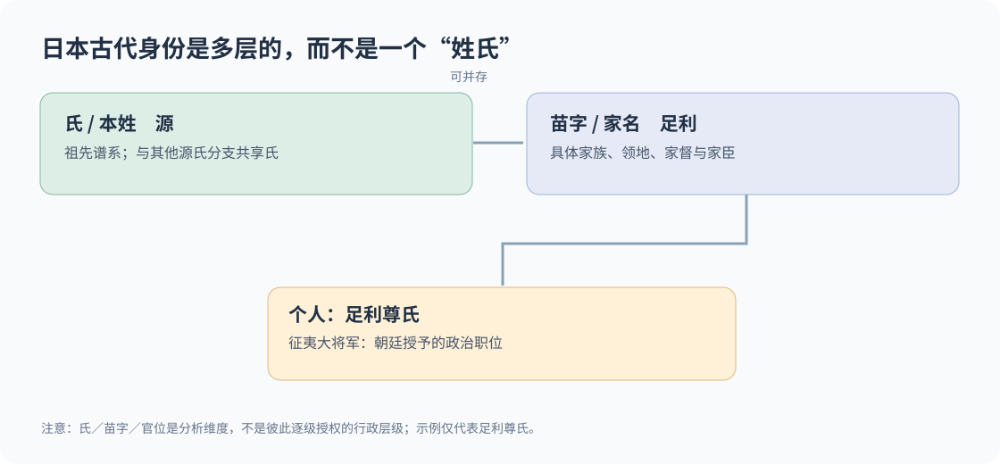
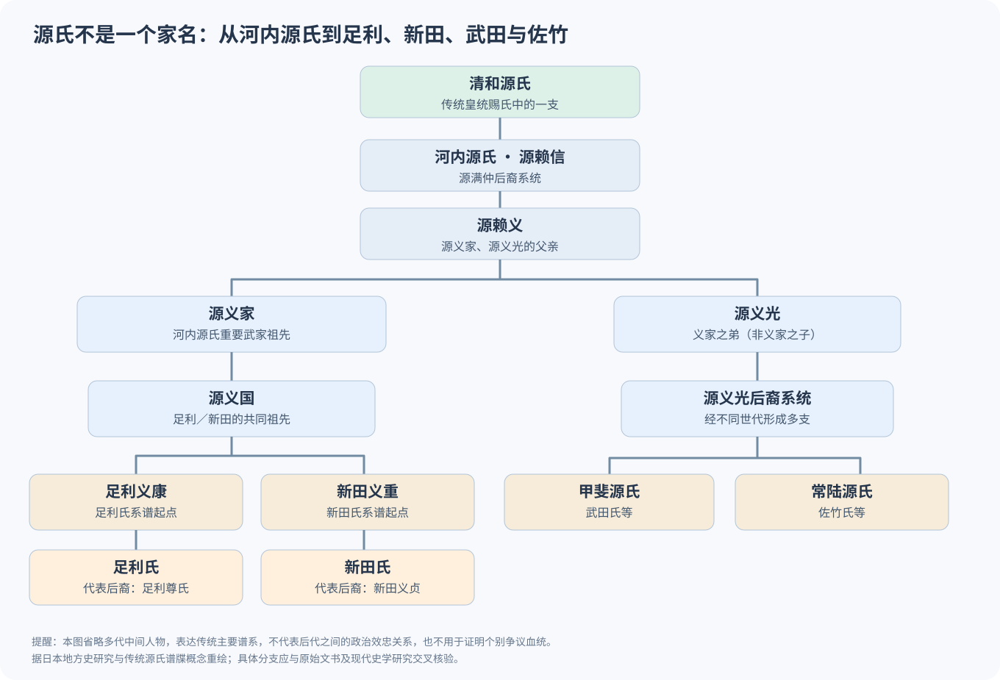
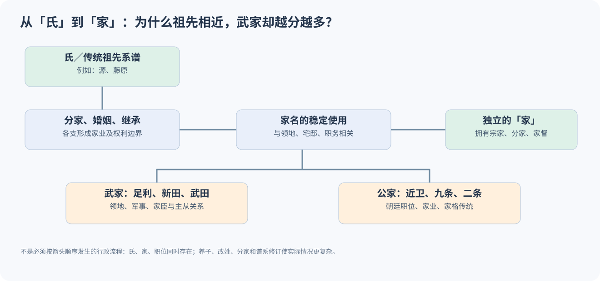
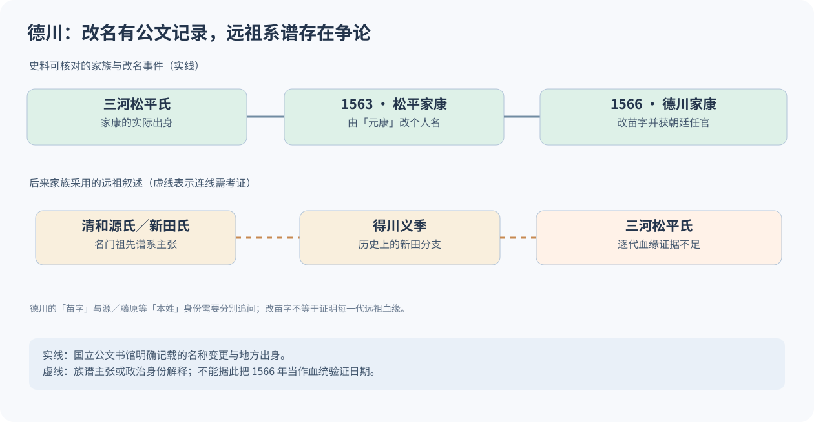
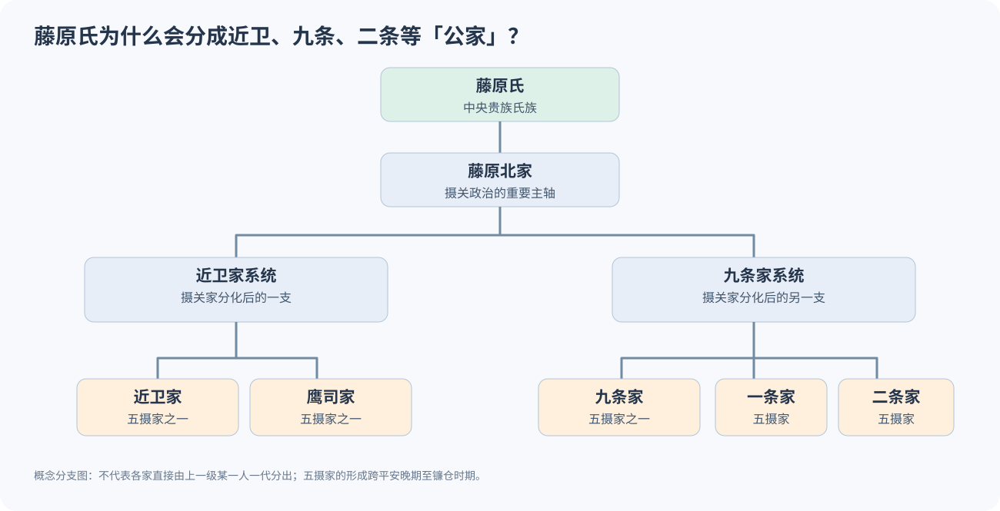

# 日本古代姓氏制度：从天皇、源平藤橘到足利与德川

> **主线问题：** 天皇为什么没有姓？源氏为什么会出现足利、武田、新田？藤原氏为什么又分出近卫、九条？德川家康原本是松平，为何专门改称德川？
>
> **一句话答案：** 日本古代存在彼此叠加、并且随着时代改变的身份体系：**皇族身份 → 氏（氏族／本姓）与姓（kabane）→ 苗字／家名 → 家督、领地和官位**。足利可以在氏族归属上属于源氏，同时在现实政治上构成独立的足利家；德川则需要把**改名事件**与**未获独立证实的祖先系谱**分开讨论。

**阅读地图**

1. [先搭框架：日本古人到底有几种「姓」？](#一先搭框架日本古人到底有几种姓)
2. [制度怎样演化：从氏姓制度到武士家名](#二制度怎样演化从氏姓制度到武士家名)
3. [源平藤橘是什么，天皇为何无姓](#三源平藤橘是什么天皇为何无姓)
4. [清和源氏为何分出这么多家](#四清和源氏为什么分出这么多家)
5. [分家以后为什么不继续都叫源](#五分家以后为什么不继续都叫源)
6. [德川家康为何从松平改称德川](#六德川家康为何从松平改称德川)
7. [藤原氏的公家分家：近卫、九条与五摄家](#七藤原氏的公家分家近卫九条与五摄家)
8. [把氏、家、官职与公武关系放在一起](#八把氏家官职与公武关系放在一起)
9. [判断古代日本人姓名的操作方法](#九判断古代日本人姓名的操作方法)
10. [史料与争议边界](#十史料与争议边界)

---

## 一、先搭框架：日本古人到底有几种「姓」？

中文的「姓」容易让人把**氏、姓（kabane）、本姓、苗字、家名、通称、讳、官位**全部误看成今天的「姓＋名」。古代日本并非如此。

| 层次 | 日本术语 | 回答的问题 | 具体例子 | 容易误解的地方 |
| --- | --- | --- | --- | --- |
| **皇族身份** | 皇族／皇統 | 是不是皇室成员？ | 清和天皇、嵯峨天皇 | 皇族不按臣籍氏姓命名 |
| **氏** | うじ（uji） | 在朝廷氏族秩序中归属哪个氏？ | 源、平、藤原、橘 | 氏不能简化成现代父系 DNA 家谱 |
| **古代的「姓」** | かばね（kabane） | 朝廷给氏族／成员什么身份称号？ | 朝臣、宿祢 | 「姓」字此处一般不是今天的 surname |
| **本姓** | ほんせい（honsei） | 相对于苗字的传统氏族本名是什么？ | 源朝臣、藤原朝臣 | 本姓与苗字可能并存；谱系自称须核验 |
| **苗字／名字** | みょうじ（myōji） | 现实中属于哪一个「家」？ | 足利、武田、近卫、松平 | 不限武士，公家也有家名 |
| **家、家督** | いえ／かとく | 谁继承家名、家业、权利与关系网络？ | 足利宗家、德川宗家 | 家的延续不总是纯直系血缘 |
| **实名／讳** | いみな（imina） | 个人叫什么？ | 尊氏、家康、赖朝 | 不是所有场合都用实名相称 |
| **通称／官途名** | 通称／官途名 | 平时如何称呼，或用什么官名？ | 次郎三郎、三河守 | 称号、通称与真实官职也须区分 |

*史料提示：氏和姓的语义随古代、平安和中世发生变化。不能把它们当作跨越千年的不变术语。参见 [USC 日本前近代史研究计划关于 uji／kabane 语义的报告](https://www.uscppjs.org/uscmeiji-university-exchange/2018/12/30/tomokazu-nakamura-the-terms-uji-kabane-and-shizokuchanging-meanings-through-time)，以及 [国立国会图书馆：姓氏、苗字研究指南](https://ndlsearch.ndl.go.jp/rnavi/humanities/post_1126)。*

### 用三个真实人物理解

| 历史人物 | 氏／本姓 | 主要家名／苗字 | 个人名 | 额外身份 |
| --- | --- | --- | --- | --- |
| 源赖朝 | 源（清和源氏、河内源氏） | 通常以源赖朝称呼 | 赖朝 | 1192 年任征夷大将军 |
| 足利尊氏 | 源（按足利家传统系谱） | 足利 | 尊氏 | 室町幕府将军 |
| 德川家康 | 曾使用藤原、源等身份表述，历程复杂 | 松平 → 德川 | 家康 | 三河守、征夷大将军等 |

所以**「足利尊氏姓源还是姓足利？」不是非此即彼的问题**。日常称呼的「足利」是武家家名；正式氏族身份的「源」属于另一套表达。称「德川家康是清和源氏后裔」时，更要进一步区分自称和证实。

---

## 二、制度怎样演化：从氏姓制度到武士家名

| 时段 | 主要身份机制 | 名字的政治功能 |
| --- | --- | --- |
| 古坟—飞鸟时代 | 氏与姓（kabane）；大和王权整合地方豪族 | 区分氏族与朝廷秩序中的身份 |
| 684 年 | 天武天皇实行「八色之姓」改革 | 朝臣、宿祢等姓成为重组氏族秩序的称号 |
| 奈良—平安前期 | 律令官位体系与部分皇族降臣籍 | 「源」「平」等赐氏进入臣下身份系统 |
| 平安中后期 | 贵族、公家之家与地方武士的家业、领地联系增强 | 以宅邸、领地、职务来源等形成家名 |
| 镰仓—室町时代 | 武士领地、分家与家督继承制度发展 | 苗字常用于区分独立的地域武家 |
| 战国—江户时代 | 大名、家臣团与政治性改姓、受赐名号 | 家名服务于统治、继承、外交与声望 |

**这不是「古代只有氏、后来氏完全消失」的替换史。** 正式文书、日常称呼、家谱、官位与地方社会同时使用多套命名方式。现代全民使用固定姓氏，是更晚的明治改革结果，不能倒推到战国时代。

研究日本苗字形成与地名、庄园、家纹、宗族迁徙关系，可从史家丰田武《[苗字の歴史](https://ndlsearch.ndl.go.jp/books/R100000002-I023769764)》的目录和相关专著入手。国立国会图书馆的索引**证明有该研究文献，不等于本文已经阅读了全书**。

---

## 三、源平藤橘是什么？天皇为何无姓？

### 3.1 天皇与臣籍氏族不是一回事

日本传统皇统中的天皇不采用普通臣籍氏姓；皇族成员通常使用个人名字、宫号、身份称号，而非「源／平／藤原」作为现代意义的家族姓。日本宫内厅也按个人名字和皇族身份记载皇室成员，例如「德仁」而不是一个「姓德、名仁」的结构：[宫内厅皇室成员介绍](https://www.kunaicho.go.jp/learn/about/history/history01.html)。

**关键转折是「臣籍降下」**：一部分皇子、皇孙退出皇族身份，进入臣下体系，朝廷赐予「源」或「平」这样的氏。这不是所有皇室成员统一改姓，更不表示只要源氏后裔就能自动返回皇族。

### 3.2 「源氏」不是唯一一棵从单一祖先长出来的树

| 赐氏系谱（例） | 所关联的天皇 | 与武家史的关系 |
| --- | --- | --- |
| 嵯峨源氏 | 嵯峨天皇 | 不等同于清和源氏 |
| 清和源氏 | 清和天皇系 | 河内源氏、足利、新田等武家系谱尤其著名 |
| 宇多源氏 | 宇多天皇 | 有与中央官僚和地方武士相关的支系 |
| 村上源氏 | 村上天皇 | 一些分支成为重要公家家系 |

因此必须区分：

- **源氏**：多个赐氏来源共用的氏。
- **清和源氏**：其中的一支。
- **河内源氏**：清和源氏的重要武家系谱。
- **足利、新田、武田**：再往下的具体武家家名，不是所有都直接从同一个人一代分出。

### 3.3 「源平藤橘」四大氏是不是日本所有姓氏的祖宗？

不是。它们是后世常被并举的著名氏族，而非覆盖全体日本人的四个姓氏分类箱。

| 氏 | 大致来源 | 著名人物与政治轨迹 |
| --- | --- | --- |
| **源** | 多次皇族臣籍降下而受赐 | 源赖朝；足利、新田、武田等传统武家谱系 |
| **平** | 同样存在不同皇统赐氏支系 | 桓武平氏；平清盛、北条氏的传统系谱 |
| **藤原** | 中臣镰足获赐藤原氏，其后形成众多分家 | 藤原道长；五摄家等公家家系，也有地方武家 |
| **橘** | 奈良时代形成的有力臣下氏族 | 橘诸兄等；政治影响力随时代变化 |

**两个反例可避免误解：** 北条氏的传统本姓是「平」，但政治上是独立的北条家；藤原氏后裔并不全是只留在京都的文官，也可以发展为地方武士。氏、家名与职业／阶级不是一一对应关系。

---

## 四、清和源氏为什么分出这么多家？

### 4.1 先看较完整的关键世代

**阅读这张图要抓住三个分岔点：**

1. 清和源氏中的「河内源氏」通常追溯到源赖信一系，经源赖义到源义家。
2. **源义家之子源义国**，经新田义重、足利义康等支系，发展出新田氏和足利氏。
3. **源义家的弟弟源义光**所属系统，后来与甲斐源氏中的武田氏以及常陆佐竹氏相关。

这并不是「清和源氏 → 足利氏、武田氏、新田氏」三条直接一跳到位的线；中间相隔多代，具体谱牒亦要按分支核实。

### 4.2 足利与新田：从兄弟分支走向不同政治道路

以源义国的后代为例：

| 分支 | 形成的家名 | 土地与政治后果 |
| --- | --- | --- |
| 源义国 → 足利义康 | **足利氏** | 依足利一带的家业和领地联系形成武家，后有足利尊氏 |
| 源义国 → 新田义重 | **新田氏** | 以新田庄为核心发展，新田义贞为其著名后裔 |
| 新田义重的分支 | **世良田／得川氏**等 | 在新田庄内以不同地域名形成分家 |

这一层分化并非单纯猜想。群马县太田市的《[国指定史迹：新田庄遗迹](https://www.city.ota.gunma.jp/uploaded/attachment/10766.pdf)》说明，新田义重的子孙分布在庄园各乡村、采用当地郷村名；并载有新田、足利家系图（特别参见资料第 4 页）。**地方史迹材料能证明家名与领地的关系，但其中转述的德川家族远祖传承仍要另行考证。**

最有意思的后果：足利尊氏与新田义贞虽然出自相关源氏支系，但在南北朝政治冲突中站到对立阵营。**共同祖先不能推导出一致的政治立场。**

### 4.3 武田与佐竹：源义光一系的扩展

武田氏与佐竹氏都在传统谱牒中归于源义光所出的系谱，但各分支经不同子孙、不同区域发展。武田与甲斐地区紧密相连，佐竹与常陆地区密切相关。

这解释了为何同一氏族下的武家在战国时代可能分别拥有完全独立的领国、家臣团和利益：**共同祖先只说明谱系叙述；现实的家与领地已经分化。**

---

## 五、分家以后为什么不继续都叫「源」？

这里要区分**「为什么出现新家名」**和**「为什么愿意使用新家名」**。

### 5.1 地名形成家名：确定「是哪一家」

地方武士与特定庄园、乡村、领地相联系，家名常取自该地。例如足利、新田、北条。这个机制并非凭空臆测：日本史研究和地方史料都保留了大量名字地（名字の地）与武士在地域扩散中的实例。

### 5.2 分家与继承：兄弟各自形成独立家业

父辈拥有的政治资源并不保证全部后代共同经营。子孙分领土地、分别经营家产、建立主从关系，就会出现不同家名；嫡流与庶流也因此可能逐渐发展出不同地位。

### 5.3 家督比遥远祖先更决定现实行动

家督（家族领导和继承地位）、家领（家族所占有或享有权益的土地）、家臣团与政治同盟通常围绕某个具体「家」运作，而不是要求所有「源氏」成员一致服从一个共同祖先。

**对同一氏族来说，可以「同祖、异家、异领、异主君」。**

### 5.4 收养、婚姻、政治许可还会改变家名连续性

家不仅是血缘集合，也是可跨越世代继承的制度性单位。养子、婿养子、改姓与受赐名字会影响家名延续。由此不能看到相同苗字就认定父系血缘完全相同，也不能看到不同苗字就认定没有祖先联系。

### 5.5 家纹是身份线索，不是血缘身份证

家纹可用于显示家族传统和政治关联，但同纹可能跨家族使用，一家也可能使用多种纹样。**不能仅凭三叶葵、笹龙胆、藤纹等图案就认定某个现代人属于特定古代武家。**

---

## 六、德川家康为何从松平改称德川？

这个案例最能说明：**改苗字是一件可考的政治事件；远祖是谁则是另一个证据问题。**

*图：德川家康「东照大权现」肖像，17 世纪绘画，传统归于狩野探幽。[Wikimedia Commons 作品说明与授权](https://commons.wikimedia.org/wiki/File:Tokugawa_Ieyasu.jpg)。*

### 6.1 可明确核对的事件：先改个人名，再改苗字

| 时间 | 名称或身份变化 | 意义 |
| --- | --- | --- |
| 幼年 | 竹千代；出身三河松平氏 | **松平**是实际家族出身 |
| 1563 年 | **松平元康 → 松平家康** | 脱离今川氏影响的政治独立进程 |
| 1566 年末 | **松平 → 德川**；获得朝廷叙位任官 | 改苗字与获得朝廷承认结合 |
| 1603 年 | 就任征夷大将军 | 与 1566 年改姓相隔约 37 年 |

以上年代与政治背景可直接参见日本**国立公文书馆**的专题：[「徳川」への改姓と「家康」への改名](https://www.archives.go.jp/exhibition/digital/ieyasu/contents1_04/)。其中还提到协助办理朝廷任官和改姓的关白近卫前久，以及中介者泰翁。此处不需要依赖晚近网络传闻。

### 6.2 为什么偏偏挑中「德川」？

上野国新田庄历史上存在「得川／德川」这一地域和家系称呼。新田义重之子义季又有「世良田义季」「得川义季」等称谓。将「松平」与「得川」联系起来，就能为一个崛起中的三河武家建立通往**新田氏—清和源氏名门**的祖先叙述。

可将选择逻辑拆为三层：

1. **历史名号资源：**「得川」并非完全凭空发明，与新田庄历史具有连接点。
2. **家名的独立识别：**「德川」可以成为这个新兴统治家族的专用标识，而无须直接使用其他家族已经沿用的「新田」。
3. **朝廷政治身份：**1566 年的改姓与受官同时发生，符合家康从地方领主迈向更高政治地位的过程。

其中第 1、3 点有地方史料和公文书馆史料的直接支撑；第 2 点属于**对政治功能的合理解释**，不能写成有文书记录「家康在新田、源和德川三个候选中选了德川」。

### 6.3 最重要的证据区分：得川义季是历史人物，不等于松平家康必为其直系子孙

- **较有把握：** 家康属于三河松平氏；1563 年改个人名，1566 年改用德川并受官。
- **有地方史与家族叙述依据：** 新田庄存在得川分家，德川家把得川义季视作祖先。
- **仍待考证：** 得川义季到三河松平氏之间每一代的连续血缘。传统家谱不能替代逐代同时代文书。
- **学界还讨论：** 家康在不同阶段与「藤原氏」「源氏」身份的关联及具体切换时点，并不适合写成单线确定故事。

例如，笠谷和比古《[徳川家康の源氏改姓問題](https://ndlsearch.ndl.go.jp/books/R000000025-I013420002273746)》（《日本研究》16，1997）明确将这一问题作为需要检视朝廷任官文书的研究争议。山梨县立图书馆的[参考调查](https://crd.ndl.go.jp/reference/entry/reference/show?asc=desc&fi=3_%E4%BA%8B%E5%AE%9F%E8%AA%BF%E6%9F%BB+6_0+5_%E7%A4%BE%E4%BC%9A%E4%BA%BA+4_%E4%BC%9D%E8%A8%98%E3%83%BB%E4%BA%BA%E7%89%A9&id=1000076949&lsmp=1&mcmd=25&page=ref_view&rnk=1&st=update&type=reference)还指出改苗字当时的藤原氏身份问题。两者说明**「改苗字」与「更改／使用氏族身份」不是同一个动作**。

### 6.4 改德川就是为了当将军吗？

不能这么写。1566 年到 1603 年相隔很久，把两件事直接连接为唯一动机，是结果倒推原因。同时也**不能宣称存在一条始终有效且严格排他的「只有源氏才能做将军」法条**。将军的形成涉及军事权力、当时的朝廷政治、具体任命和历史情势。

**结论：德川是一项有历史地名依据且经朝廷认可的家名选择；德川家对清和源氏的自我系谱定位，是另外一个证据层次。**

---

## 七、藤原氏的公家分家：近卫、九条与五摄家

如果「源氏改用地名作武家家名」，那为什么「藤原氏又出现近卫、九条、二条、一条、鹰司」？

因为**公家也会按宅邸地名、家业与继承关系形成具体的家名**。区别主要是政治资源类型：藤原摄关家的核心资源在朝廷官职、婚姻、家格、礼仪传统；地方武家的核心资源更多是领地、军事和家臣。

五摄家通常指**近卫家、鹰司家、九条家、二条家、一条家**。它们是在藤原北家摄关家系发展中逐渐形成的不同家，而不是「藤原」这个氏消失了。注意五摄家形成于平安晚期至镰仓时期的分化过程，不能把它们全部投射到藤原道长在世之时。

| 对比点 | 河内源氏等武家 | 藤原五摄家等公家 |
| --- | --- | --- |
| 宽泛氏族身份 | 源 | 藤原 |
| 新家名形成基础 | 领地、居馆、分支 | 邸宅与家名、官职传统、分支 |
| 继承核心 | 家督、家领、家臣与军事网络 | 家格、家业、朝廷官职资格 |
| 具体家名 | 足利、新田、武田等 | 近卫、九条、一条、二条、鹰司 |
| 现实政治 | 不同分家可能结盟或交战 | 不同摄家也存在竞争、继承冲突 |

五摄家分化的研究可参见关于二条家与家格秩序的论文《[家格の秩序と二条家](https://www.u-tokai.ac.jp/uploads/sites/9/2021/03/03.pdf)》（本文只据可核对的摘要确认研究主题，不以摘要代替全文细节）。

---

## 八、把氏、家、官职与公武关系放在一起

日本古代的权力结构不是「皇统 → 氏族 → 家 → 官职」这样逐级任命的行政树。它是**多套彼此联系、又可能不一致的身份网络**。

| 观察对象 | 回答的问题 | 典型资源 |
| --- | --- | --- |
| 皇统与朝廷 | 谁具有授予官位、礼制与皇权合法性？ | 皇位、朝廷仪礼、官职 |
| 氏／本姓 | 传统谱系如何定位？ | 历史声望、身份叙述 |
| 家（公家或武家） | 谁继承这一个组织及其财产和关系？ | 家督、家业、家领 |
| 地方领地与庄园 | 谁实际收取收入、调解争端或控制土地？ | 收益权、管理权、军事保障 |
| 幕府及将军 | 谁在特定时代组织大范围武家政治？ | 御家人、守护／地头、军政机构 |

这也解释了一个常见悖论：**天皇没有普通姓氏，却能提供官位正统性；将军拥有苗字及武家组织，却仍可能依靠朝廷任命；公家与武家在现实中也会相互联姻、任官和争夺土地权益。**

关于摄关政治、院政、庄园和武士集团如何共同推动这套结构变化，请读关联专题：

**[公家、武家与幕府：平安时代的权力如何转向地方武士？](公家武家与幕府权力转型.md)** · [[_wiki/History/Japan/公家武家与幕府权力转型|Obsidian 知识链接]]

---

## 九、判断古代日本人姓名的操作方法

遇到某个人名，不要马上问「他姓什么」，先依次检查：

1. **时代与语境：** 古代律令官员、平安公卿、镰仓武士、战国大名和江户官僚，命名习惯并不相同。
2. **所给名字的层次：** 是氏（源、藤原），还是苗字（足利、德川），还是通称、官途名、个人实讳？
3. **家谱的性质：** 同时代文书证实、地方史料沿用、还是晚世系图自称？
4. **真实家业与政治关系：** 家督、庄园、官位、主从关系是什么？同氏者之间有无独立组织？
5. **有无改名／赐氏／养子：** 个人改名、苗字改变和本姓自称不是一回事。

用四个快速判断校验理解：

| 判断题 | 答案 |
| --- | --- |
| 「足利尊氏既属于源氏又属于足利家」 | 正确；不同身份层次 |
| 「平清盛与北条时政都在平氏谱系下，因此必属同一政治组织」 | 错；同氏不等于同家同主 |
| 「近卫家属于藤原氏，所以近卫不是家名」 | 错；公家同样有家名 |
| 「德川改姓已经证明家康的每一代远祖血缘」 | 错；改姓事件与家谱事实必须分开 |

---

## 十、史料与争议边界

### 10.1 资料分层

| 类型 | 本文采用的来源 | 适用范围 |
| --- | --- | --- |
| 官方史料展览与历史材料 | [日本国立公文书馆：家康改名及改姓](https://www.archives.go.jp/exhibition/digital/ieyasu/contents1_04/) | 1563／1566 年事件、朝廷授官与相关人物 |
| 地方文化财历史研究 | [群马县太田市：新田庄遗迹（PDF）](https://www.city.ota.gunma.jp/uploaded/attachment/10766.pdf) | 新田庄、家名地域化、得川义季的地方传统 |
| 专门史研究与书目 | [笠谷和比古：德川家康的源氏改姓问题（1997）](https://ndlsearch.ndl.go.jp/books/R000000025-I013420002273746) | 德川本姓问题的争议及研究路径 |
| 日本姓氏史学术文献 | [丰田武《苗字の歴史》](https://ndlsearch.ndl.go.jp/books/R100000002-I023769764) | 家名、领地、分家和苗字史的系统研究（仅核对书目信息） |
| 姓氏研究工具 | [国立国会图书馆：姓氏／苗字调查指南](https://ndlsearch.ndl.go.jp/rnavi/humanities/post_1126) | 检索家谱研究、辞典、地名资料的入口 |
| 学术概念讨论 | [USC／明治大学史学交流：氏与姓的语义演变](https://www.uscppjs.org/uscmeiji-university-exchange/2018/12/30/tomokazu-nakamura-the-terms-uji-kabane-and-shizokuchanging-meanings-through-time) | 避免将 uji／kabane 当作不变概念 |
| 图像史料 | [Wikimedia Commons：德川家康肖像](https://commons.wikimedia.org/wiki/File:Tokugawa_Ieyasu.jpg) | 17 世纪的后世历史肖像，非事件当时写真 |

### 10.2 不能直接下结论的地方

- **系图不是天然的血缘证书：** 历史上的养子继承、政治性谱系和后世增补使连续血统需要逐段核查。
- **「源平藤橘」不等于全日本人姓氏之根：** 还有许多氏族、地方家系与不同时代新形成的家名。
- **姓／氏等词义有时代差异：** 当代汉语、日常日语和律令文书中的用法不同。
- **家名与领地的关系不是唯一成因：** 官职、宅邸、产业、亲族继承等都可能影响家名。
- **本页是可复查的综合学习笔记，不是新发现的古代文书。** 谱系图的实线表达传统谱系关系，若未有逐代可靠史料支持，仍只应视作谱牒传统。

### 原始讨论与维护记录

- [[_sources/conversations/2026-11/japanese-clans-kuge-buke-discussion|2026-11 日本古代姓氏与公武制度讨论摘录]]：[来源](../../../_sources/conversations/2026-11/japanese-clans-kuge-buke-discussion.md)。这是精选问题，不是逐字对话全文。
- 配套图表存于本目录的 [assets/](assets/)；全部 SVG 为原创教学图，第三方历史肖像通过 Commons 外链使用。
- 相关页：[[ _wiki/History/Japan/公家武家与幕府权力转型 ]]（实际可点击路径见上方链接）。
