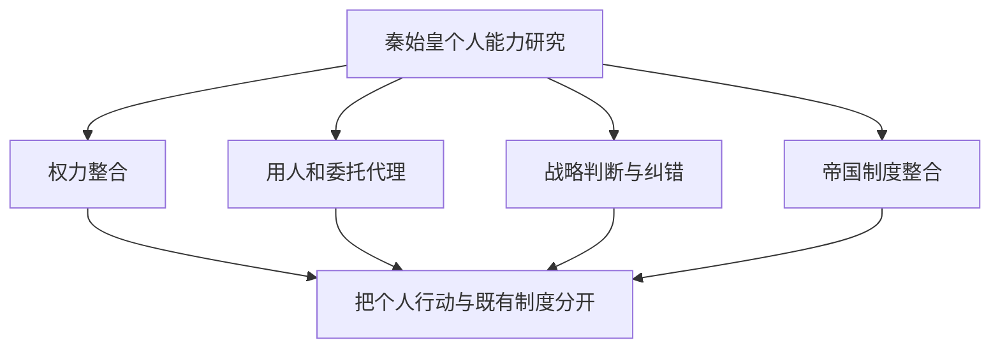
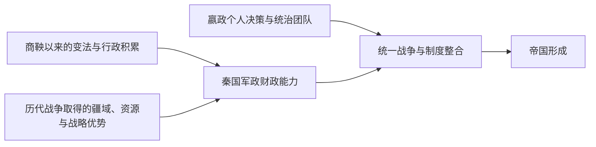

# 秦始皇的个人政治能力：亲政、用人、战略决策与治理边界

## 核心判断

秦始皇个人能力的讨论，应把**可直接看到的决策与结果**、**秦国既有制度能力**和**史书无法验证的个性与动机**分开。嬴政亲政时期在权力整合、用人和组织统一战争方面留下了重要行动记录；这可以支撑对其政治决策的分析，但不足以推导他的智力排名、心理特征或独自指挥每一场战役。

本页回应此前讨论中的“20岁就平定叛乱？”与“所以他个人能力是不是极其之强？”——对重大结果的解释需要分清行动者和国家机器。

## 一、关键事件：事实、能力解释与不能推断的部分

| 时间与事件 | 可依据史料讨论的行动 | 可作的有限解释 | 不能直接推出 |
| --- | --- | --- | --- |
| 前247年，继承秦王位 | 嬴政大约13虚岁即位，年少时政务由重臣参与处理 | 提前进入权力结构 | 13岁即独立治理或军事指挥 |
| 前238年，嫪毐之乱 | 嬴政举行冠礼前后，嫪毐集团发动叛乱；秦王命昌平君、昌文君等组织平叛 | 能使用王权及支持他的政治军事网络处理危机 | 嬴政21岁亲自率军冲锋或全靠个人完成镇压 |
| 随后的吕不韦失势 | 相国政治影响受到限制，秦王进一步集中决策权 | 权力整合和政治支持网络的变化 | 可以还原所有私下动机与完整宫廷权谋 |
| 前230—前221年，六国统一 | 多路军事行动、外交与行政动员持续协同 | 最高决策层形成并执行连续征服战略 | 每一项军事计策均由嬴政本人原创 |
| 攻楚受挫后更换方案 | 《史记》载李信用兵失败，秦始皇重新起用王翦 | 至少留下重大误判后调整人事和方案的记录 | 所有对话和六十万兵力数字均经独立证实 |
| 前221年后帝国治理 | 皇帝制度、郡县行政、书写及度量衡规范化继续推广 | 决策关注由征服扩至帝国级行政统合 | 原有制度均为秦始皇发明，或可持续治理已成功 |

这里尤其要区分**能批准资源调配**与**亲自指挥战场战术**。王翦、王贲、李斯等人，以及秦国既有征发与官僚体系，都有独立贡献。

## 二、评价政治能力应观察哪几个维度？

### 权力整合

平定嫪毐叛乱之后，嬴政逐步摆脱朝廷中此前强势人物的政治影响。这个过程体现君主权力的重新配置，也依赖王室合法性和拥护中央的官员、军队；**不能用结果反推其单独掌握一切情报**。

### 用人和委托—代理

王翦伐楚故事可用委托—代理、可信信号作现代类比：君主需要将领掌握大量资源，又有对军权独立的顾虑。《史记》记载王翦索取田宅的行为，但其真实动机及君臣对话不能视为心理实验或准确录音。

### 战略判断与纠错

李信攻楚失败、王翦重新出山，能够帮助识别“一次错误战略决策之后是否改变方案”这个问题。但王翦提供的新方案能成功，也要归功于兵员、后勤和将领执行，不能把调整等同于个人永远正确。

### 制度整合与限度

全国性行政标准化有历史意义，但统一后征发压力、地方整合和继承治理也存在深刻危机。对征服决策的观察和对长久治理的观察，采用的证据标准应当不同。

## 三、为什么“强大的君主”与“强大的国家”不能混为一谈？

秦在嬴政即位前已取得巴蜀和关中资源，建立军功、官僚和征发机制。认为“换任何秦王也一定按时统一”是不能验证的反事实；认为“六国是嬴政单人打下来的”则忽视大量制度和团队行动。

## 四、短期成绩与长期治理

秦始皇处理过战争与政治整合中的重大问题；但新帝国需要在财政、地方社会合作和皇位继承方面形成可重复运转的机制。秦亡涉及多个层级的矛盾，不能把后来发生的每件事都当作嬴政个人能力的直接测验。

反事实“再活二十年会怎样？”只能提出条件：原本在前210年触发的继承危机不会按原样发生；长期征发、权力继承安排等问题仍需要实质处理。**延寿不是国家持续稳定的证明**。

## 五、研究结论与局限

可以讨论嬴政在权力整合、战略组织、任用人才、纠正重大决策失误方面的历史行动。我们无法从现存史书客观计算他的“领导力分数”，也不能把《史记》中有文学叙事色彩的对话当成直接实验数据。

评价他个人能力时，有用的研究问题是：**相对于秦国已有实力，哪些决策与资源重新配置能够归因于君主及其团队？**

## 关联知识

- [[_wiki/History/Comparisons/秦始皇的历史功绩与帝王比较|秦始皇的历史功绩与帝王比较]]：个人能力与长期制度影响应分开判断。
- [[_wiki/History/Questions/秦统一与秦朝速亡|秦统一与秦朝速亡]]：六国联盟和秦亡的综合解释。
- [[_wiki/SystemsThinking/胜利后的战略转型|胜利后的战略转型]]：系统目标变化与旧策略的适应性问题。

## 资料与证据

- [[_sources/conversations/2026-10/qin-unification-conversation|秦史原讨论节选]]：包括用户关于年轻亲政及个人能力的原句；并非完整逐字记录。
- [《史记·秦始皇本纪》](https://ctext.org/shiji/qin-shi-huang-ben-ji)：即位、亲政、军事和朝廷政治记录，引用动机时须谨慎。
- 《史记·白起王翦列传》《史记·吕不韦列传》：关于将领调配和嫪毐、吕不韦政治事件的传统叙述。
- Yuri Pines, [“Institutional Reforms and Reformers during the Warring States Period”](https://cris.huji.ac.il/en/publications/institutional-reforms-and-reformers-during-the-warring-states-per/) (2020)：秦的军功与国家动员制度是长期建设结果。
- [原讨论稿：秦统一与治理转型](../../../systems-thinking/qin-unification-strategy-transition.md)。

## 待考证

- 嫪毐叛乱参与者的官职、政治关系与不同史料之间的差异。
- 李信、王翦伐楚的数字与战事叙述能否用其他材料交叉确认。
- 秦初官僚行政的地方执行状况，尤其是与后来的出土秦简材料对照。
