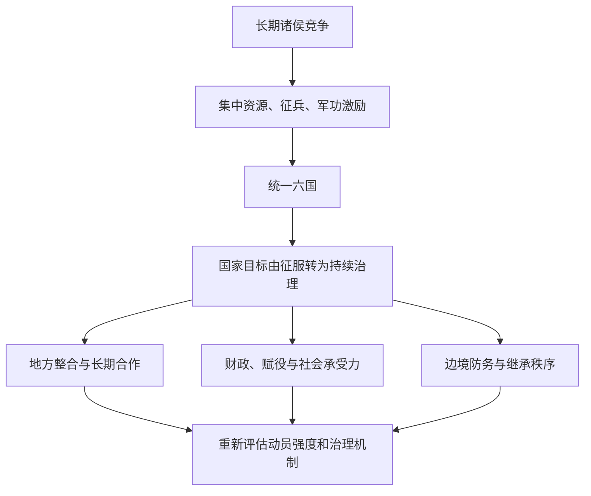

# 秦统一与秦朝速亡：如何理解两种国家能力的转换？

## 问题

**为什么秦国能够在约十年内消灭六国，秦朝却在统一后约十四年就灭亡？秦始皇个人能力、六国联盟困境与制度转型，各自起什么作用？**

## 结论

秦的统一首先依赖长期形成的财政、行政、军事和战略优势；统一战争中又利用六国之间利益不一致、合纵联盟难以持续协调的条件。秦始皇主持了最后阶段的征服与帝国制度整合，但这些能力并不自动解决统一后的新问题：如何控制赋役成本、整合旧六国地区、维系地方合作和安排稳定继承。

**解释秦朝兴亡时，应同时考察“对外征服的组织能力”和“对内长期治理的可持续性”；不能用一项能力的成功推断另一项必然成功。**

本页是知识综合：历史事件依据《史记》等记载；博弈论与《矛盾论》属于后世解释工具，不能归为秦始皇本人的思想。

## 历史边界：个人能力与既有优势

| 时间 | 历史事件 | 对判断的意义 |
| --- | --- | --- |
| 前247年 | 嬴政继承秦王位，约13虚岁 | 即位与掌握全部实权是两回事 |
| 前238年 | 冠礼与嫪毐之乱 | 秦王命昌平君、昌文君等平叛；不能据此说亲自领军 |
| 前230—前221年 | 先后灭韩、赵、魏、楚、燕、齐 | 最终统一发生在约十年的集中征服阶段 |
| 前221年 | 建立皇帝政权，推广全国性制度 | 国家战略问题从“赢得战争”转向“长期治理” |
| 前210年、前207年 | 秦始皇去世；秦朝灭亡 | 继承危机与长期治理问题需要同时分析 |

秦的制度优势经过商鞅变法、巴蜀经营和历代兼并战争积累。李牧曾抗击秦军；李信伐楚失败后秦重新任用王翦。上述事实提示：统一既非嬴政一人凭空完成，也不是没有风险的必然结果。《史记》涉及人物对话和兵力数字的叙述，需注意证据局限。

## 博弈解释：为什么六国没有长期结成稳固联盟？

对六国整体而言，遏制秦的扩张具有共同利益；但对每一个诸侯国而言，参与抗秦意味着即时军费、伤亡和政治成本。一个国家可能希望其他国家多承担负担，自己在短期内保留军力、与秦谈判甚至争取利益。

这构成**集体行动困境、联盟协调难题和可信承诺问题**：各国不确定盟友会否坚持出兵、是否单独媾和、胜利之后如何分配利益。六国不是条件相同的六名玩家，因此也不能把战国直接简化成标准的“囚徒困境”。

从博弈论看，秦的优势不只是“更会打仗”，还包括利用各诸侯不同的安全压力与利害关系，逐一削弱共同抵抗的条件。这是现代归纳模型，不能直接宣称“秦始皇精通博弈论”。

## 制度解释：统一后主要任务发生了什么变化？

用《矛盾论》的术语，可以把这种过程描述为**历史阶段变化引起需要优先处理的矛盾发生转化**。但旧矛盾不会凭空消失：秦朝仍有边境防务与新领土管理的需求。因此，不能把“应减少负担”推导为“应取消国家动员”。

更可检验的问题是：统一后的征发规模、法律执行、官僚控制和地方资源配置，能否形成可持续的政治秩序？秦朝的快速崩溃表明原有组合遭遇严重危机，但无法仅凭结果认定某一个政策是唯一原因。

关联概念：[[_wiki/SystemsThinking/胜利后的战略转型|胜利后的战略转型]]（Obsidian 内可用知识链接；GitHub 入口见下一行）。

[胜利后的战略转型](../../SystemsThinking/胜利后的战略转型.md)

## 秦汉与罗马：可以比较什么？

罗马也建立过地中海范围的大型帝国，因此“欧洲从未统一”并不准确。值得比较的是：秦汉建立的统一帝国模式为何被后世反复继承和重建，而西罗马帝国瓦解后，欧洲西部长期维持多中心的政治结构。

地理连通性、帝国行政传统、战争压力、地方权力和观念延续等都是被讨论的解释因素；单凭秦始皇个人才能，不能解释此后两千年的历史。

“如果秦始皇再活二十年”与“如果秦没有统一，战国会不会像欧洲”是反事实问题。可以讨论不同条件下的路径，但没有足够证据量化概率，更不能将猜测写成史实。

## 后续问题

- 《史记》与出土秦简对徭役、法律、地方行政的呈现有哪些差异？
- 战国合纵联盟中是否存在可核验的具体承诺、违约和收益分配案例？
- 西汉哪些治理制度继承了秦制，哪些进行了调整？
- 如何区分秦朝统一时的必要军事负担与统一后的政策选择？

## 资料与证据

- [[_sources/conversations/2026-10/qin-unification-conversation|秦史讨论来源节选]]：保留用户提问与六个讨论主题；为二次讨论材料，**并非完整逐字对话或一手史料**。
- [保留的早期长文（legacy）](../../../systems-thinking/qin-unification-strategy-transition.md)：从对话整理出的初版专题论述，未因 Wiki 迁移而删除。
- 司马迁：《史记·秦始皇本纪》《史记·白起王翦列传》《史记·吕不韦列传》《史记·陈涉世家》。史料中的兵力、对话及动机需审慎核验。
- 毛泽东：《矛盾论》（1937）：用于现代阶段性分析，**并非秦代文献**。
- Walter Scheidel (ed.), *Rome and China: Comparative Perspectives on Ancient World Empires* (2009)；*Escape from Rome* (2019)：用于比较史分析框架，不构成反事实证明。
