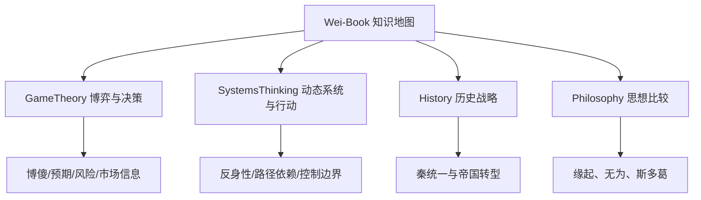

# Wei-Book · LLM Wiki 知识地图

**阅读路径：知识页优先，原始文档用于追溯。** `_wiki/` 是经整理的综合知识；`_sources/` 和未迁移删除的 legacy 目录是证据来源；`_meta/` 保存摄取、验证、变更记录。下列新知识页统一依据 [oh-my-skill / llm-wiki-maintainer](https://github.com/XiaoWeiKIN/oh-my-skill/tree/main/skills/llm-wiki-maintainer) 的页面与来源原则编制。

## 主题地图

## 博弈论与决策（GameTheory）

- [[_wiki/GameTheory/蜈蚣博弈|蜈蚣博弈]] — 自洽收益矩阵、逆向归纳与合作行为。[GitHub](GameTheory/蜈蚣博弈.md)
- [[_wiki/GameTheory/格罗斯曼-斯蒂格利茨悖论|格罗斯曼—斯蒂格利茨悖论]] — 信息搜集成本与价格效率，避免“市场必然消亡”的错误外推。[GitHub](GameTheory/格罗斯曼-斯蒂格利茨悖论.md)
- [[_wiki/GameTheory/博傻与凯恩斯选美博弈|博傻与凯恩斯选美]] — 转售预期、高阶信念和金融史轶事的证据边界。[GitHub](GameTheory/博傻与凯恩斯选美博弈.md)
- [[_wiki/GameTheory/效用与投机决策|效用与投机决策]] — 消费、投资、投机的区别及风险管理适用条件。[GitHub](GameTheory/效用与投机决策.md)

## 系统思维（SystemsThinking）

- [[_wiki/SystemsThinking/反身性与反馈回路|反身性与反馈回路]] — 参与者预期如何通过行动改变现实与基本面。[GitHub](SystemsThinking/反身性与反馈回路.md)
- [[_wiki/SystemsThinking/命运与受约束能动性|命运与受约束能动性]] — 状态转移、历史约束、选择和反馈。[GitHub](SystemsThinking/命运与受约束能动性.md)
- [[_wiki/SystemsThinking/控制边界与最小必要干预|控制边界与最小必要干预]] — BAFL 作为行动清单，区分可控输入与外部结果。[GitHub](SystemsThinking/控制边界与最小必要干预.md)
- [[_wiki/SystemsThinking/胜利后的战略转型|胜利后的战略转型]] — 目标变化、路径依赖和旧策略适应性。[GitHub](SystemsThinking/胜利后的战略转型.md)

## 历史与哲学

- [[_wiki/History/Questions/秦统一与秦朝速亡|秦统一与秦朝速亡]] — 诸侯联盟博弈、秦制与后统一治理的不同要求。[GitHub](History/Questions/秦统一与秦朝速亡.md)
- [[_wiki/Philosophy/缘起无为与控制哲学比较|缘起、无为与控制哲学比较]] — 佛教、道家、斯多葛在现代系统模型中的可比与不可比之处。[GitHub](Philosophy/缘起无为与控制哲学比较.md)

### 秦始皇与比较史（原对话遗漏主题补充）

- [[_wiki/History/Comparisons/秦始皇的历史功绩与帝王比较|秦始皇的历史功绩与帝王比较]]：政治统一、制度遗产、统治成本与帝王评价维度。[GitHub](History/Comparisons/秦始皇的历史功绩与帝王比较.md)
- [[_wiki/History/People/秦始皇的个人政治能力|秦始皇的个人政治能力]]：亲政、用人、战略纠错与制度归因。[GitHub](History/People/秦始皇的个人政治能力.md)
- [[_wiki/History/Comparisons/秦汉与罗马帝国的比较|秦汉与罗马帝国的比较]]：古代大型帝国、长期再统一与欧洲政治多中心。[GitHub](History/Comparisons/秦汉与罗马帝国的比较.md)

## Legacy 原文归档（均保留原路径）

这些原稿属于**可溯源的历史材料**，包括曾经的错误、类比和待核实断言；应优先阅读上方的已编译知识页。

- [蜈蚣博弈](../game-theory/centipede-game.md) · [博傻理论](../game-theory/greater-fool-theory.md) · [格罗斯曼—斯蒂格利茨悖论](../game-theory/grossman-stiglitz-paradox.md)
- [反身性理论](../game-theory/reflexivity-theory.md) · [效用认知与投机风控](../game-theory/utility-vs-speculation.md)
- [行动与控制统一框架](../systems-thinking/action-and-control-in-complex-systems.md) · [缘起与反身性](../systems-thinking/buddhism-daoism-reflexivity.md)
- [命运作为动态生成过程](../systems-thinking/destiny-as-dynamic-systems.md) · [命运作为动态反馈系统](../systems-thinking/reflexivity-causality-and-destiny.md)
- [秦统一与帝国治理转型原长文](../systems-thinking/qin-unification-strategy-transition.md)

## 维护导航

- [主索引](../Index.md) · [迁移与覆盖矩阵](../_meta/migration-plan.md) · [更新日志](../_meta/log.md) · [Lint 检查报告](../_meta/lint-reports/2026-10-23-wiki-migration.md)
- [秦史讨论归档](../_sources/conversations/2026-10/qin-unification-conversation.md)（经过精选的对话节选，不是完整逐字转录）
- [Agent 维护规范](../AGENTS.md)：规范来源属于 oh-my-skill，不能将旧文未经审阅直接复制为新知识。

## 原则与待完善项

1. 任何新结论必须区分**原资料**、**综合判断**和**未经检验的类比**。
2. Wiki 页面必须有稳定入站链接、来源路径、`type` 和 `updated`。
3. 原始论文、历史轶事和宗教经典的细节需要按所引版本单独考证。已编译表示内容已按知识结构整理，不代表所有旧例证都完成学术级验证。
4. `presentations/` 属于独立办公文档，`templates/` 属于模板，保持原用途，不编译成知识页。
