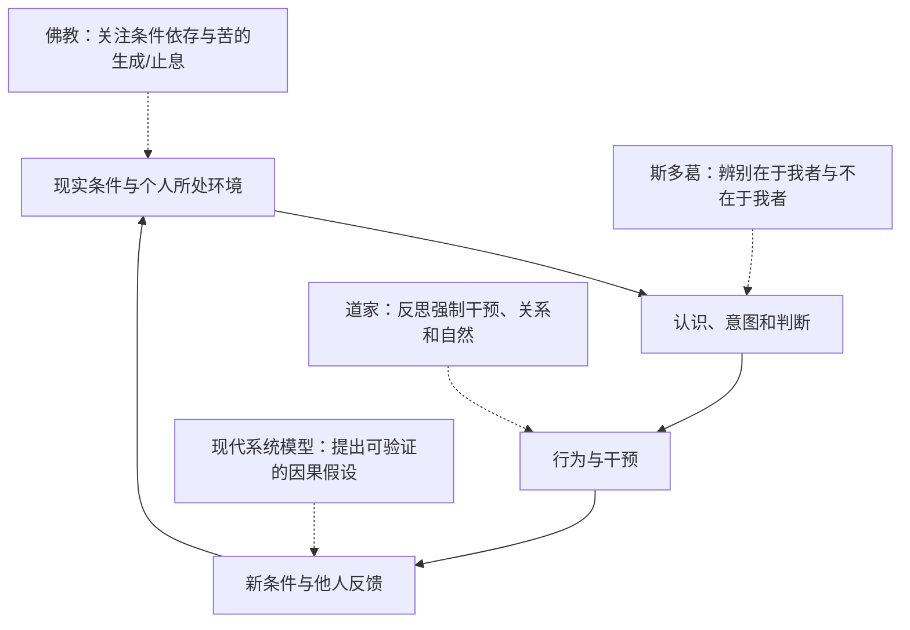

# 佛教缘起、道家无为与斯多葛：哪些类比成立，哪些不成立？

## 结论

这些传统都可以启发对**条件、行动、有限控制与反馈**的思考，但它们的经典语境、实践目标与哲学前提不同。把佛教“业”等同于系统路径依赖、把道家“无为”等同于最小干预、把斯多葛的伦理控制二分法等同于控制论输入集合，都只能是**现代分析类比**，不应写成原著的“工程本质”。

## 概念比较

| 传统 | 典型思想或问题 | 可借鉴的现代问题 | 不应混同 |
| --- | --- | --- | --- |
| 佛教：缘起 | 现象依赖条件而生，关注苦、无常、无我与修行 | 结果由多个条件交织产生，行为与习惯可能改变后续条件 | 缘起不等同于任意通用因果图；“业”亦不只是习惯 |
| 道家：无为 | 《道德经》中的无为、自然与不恃功，反对过度人为强制 | 干预可能诱发抵抗和意外后果，关注条件与关系 | 无为不等同于永远少干预或一套通用算法 |
| 斯多葛：在于我者 | 爱比克泰德区分判断、意愿等与外在事物 | 分清可直接选择的行为与不由个人决定的结果 | 伦理责任和自由不是一个系统的控制输入表 |
| 现代系统科学 | 状态变量、反馈、干预、随机扰动 | 在可检验模型中区分假设、反馈机制和指标 | 不能反过来证明古代哲学已经提出同样的数学模型 |

## 一张图：思想比较的共同分析问题

图中虚线代表**现代解释视角**，不是任何古代经典自带的科学流程图。

## 两个关键的文本边界

**《道德经》第二章**包含“有无相生，难易相成”等表达，它关涉对立概念的相待关系，不能把这几句直接当作控制论中“强干预必然导致反向适应”的实验论据。同章还讨论“无为”和“为而不恃”，解释时应结合全文与不同传本。

**《爱比克泰德手册》第一章**区分“在于我们”与“不在于我们”之事，重心是判断、意愿、伦理实践；名誉、财富等不受个人完全支配。把这一区分翻译为“任何人都只能改变自己的动作，而无法影响外部结果”同样过度简化，因为影响与完全控制并非一回事。

佛教“缘起”和“业”在不同学派和经典中的诠释复杂；单以《道德经》一句话或现代行为心理学术语，无法替代完整的经论研究。

## 实践映射：如何避免过度类比

面对人际冲突或组织压力，可以按四个层次提问：

1. 当前出现的现象依赖哪些条件？（条件识别）
2. 自己的解释是否正在推动某种自动行为？（反思与觉察）
3. 哪些行动是自己能够负责任地选择的？（行动边界）
4. 一次干预将怎样改变其他参与者的激励和反馈？（后果检验）

**这些是重新整理的分析问题，并非三大哲学传统共有的教义。**

## 与 Wiki 其他页面的分工

- [[_wiki/SystemsThinking/命运与受约束能动性|命运与受约束能动性]]：现代动态系统表达，不处理各思想传统的完整经典语境。
- [[_wiki/SystemsThinking/控制边界与最小必要干预|控制边界与最小必要干预]]：可操作的组织/工程方法，强调反馈与风险。
- [[_wiki/SystemsThinking/反身性与反馈回路|反身性]]：现代参与者认知和现实反馈机制，与各古典传统不等同。

## 资料与证据

- [原有“缘起、反作用与反身性”（legacy）](../../systems-thinking/buddhism-daoism-reflexivity.md)：各种跨传统类比的主要素材；未覆盖原文。
- [原有“行动与控制的统一框架”（legacy）](../../systems-thinking/action-and-control-in-complex-systems.md)：BAFL 行动流程与现代工程化解释。
- [原有“命运作为动态反馈系统”（legacy）](../../systems-thinking/reflexivity-causality-and-destiny.md)：相关命运与系统反馈类比。
- 《道德经》第二章，[原文及多译本](https://mouseia.org/texts/daodejing/chapter-2)；[芝加哥大学 Brook Ziporyn 对第二章的文本讨论](https://voices.uchicago.edu/ziporyn/about-chapter-two-of-the-daodejing/)。
- 爱比克泰德《手册》第一章，[Dickinson College Commentaries](https://dcc.dickinson.edu/epictetus-encheiridion/chapter-1)。
- 佛教经典因流派与文本版本差异较大，本页没有选定唯一经典为整个佛教下定义；若扩写，应从明确的传统与版本入手。

## 待更新

- 逐条审阅佛教各宗派和早期经藏对于缘起、业、无我的论述，避免凭单一现代类比替代文献考证。
