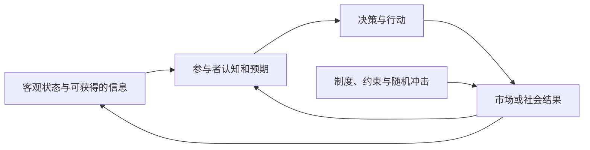
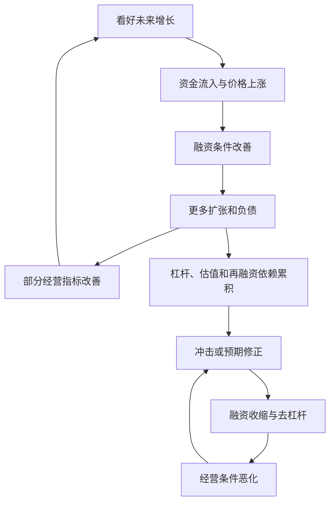

# 反身性与反馈回路：参与者的认知如何改变被认知的现实

## 定义

索罗斯的反身性（reflexivity）关注具有思考能力的参与者：**他们对现实的理解影响其行动，行动又可能改变现实，使原有判断成为反馈回路的一部分。**

索罗斯区分 **cognitive function（认知功能）** 与 **participating/manipulative function（参与/改变现实的功能）**。当两者作用于同一系统时，现实与认识不再是简单的单向因果。

注意：不是任何双向因果都等同于索罗斯的反身性，关键是**参与者的认识、预期与有意行动介入了因果过程**。

## 机制：何时价格真正改变基本面？

股价上涨 → 公司通过增发股权获得更多融资 → 扩张、研发或收购 → 盈利能力可能变化 → 市场再次调整估值。这才有“价格影响基本面”的通道；若价格变化未改变企业融资和经营，则不能仅凭资产价格上涨宣称基本面受到反身性影响。

银行挤兑是另一类机制：对流动性不足的担忧 → 提款 → 流动性进一步恶化 → 加剧担忧。它与自我实现预期、协调失败机制相关，而不是一切担忧都必然引发挤兑。

## 繁荣—萧条（Boom–Bust）只是反身性的一种表现

价格、抵押品、杠杆、融资期限和现金流共同决定反馈强度。**繁荣不一定变为崩溃**，也无法仅靠这张图预测拐点日期。

## 与相近概念的区别

| 概念 | 与反身性的关系 |
| --- | --- |
| 一般反馈回路 | 可以存在于没有认知主体的物理系统中，外延更广 |
| 自我实现预言 | 某种预期促使事件发生；反身性还研究持续的认知—现实双向更新 |
| 路径依赖 | 历史状态影响后续可行选择；不要求包含参与者对现实的预测 |
| [[_wiki/GameTheory/博傻与凯恩斯选美博弈|博傻和选美]] | 关注对未来价格和他人预期的推测，不必然改变基本面 |
| [[_wiki/GameTheory/格罗斯曼-斯蒂格利茨悖论|信息效率悖论]] | 聚焦有成本的信息生产与价格揭示，不等于“价格改变现实” |

## 一个可操作的识别模板

1. **认知变量**：参与者相信什么、依据何种信息形成预期？
2. **行为通道**：哪些交易、借贷、招聘、投资或政治决策会受到这些预期影响？
3. **现实反馈**：行为如何改变融资、产量、需求、制度或下一期可得信息？
4. **约束和断点**：是否存在杠杆率、再融资窗口、法律限制、竞争或外部冲击？
5. **证伪方式**：如果行为并未改变基本面，此处可能只有相关性或价格反馈，而不是预期的现实作用。

## 使用场景与局限

金融市场、银行挤兑、信用、社交预期与技术采纳可以出现反身性结构。但本概念本身无法告诉我们一项资产的合理价值、反转时间、单个参与者的真实意图，也不能代替数据和因果检验。

## 资料与证据

- [反身性理论旧笔记（legacy）](../../game-theory/reflexivity-theory.md)：市场价格、基本面及 Boom–Bust 的丰富实例和图解。
- [命运作为动态反馈系统旧笔记（legacy）](../../systems-thinking/reflexivity-causality-and-destiny.md)：认知—行动—环境互动的跨领域案例。
- [命运作为动态生成过程（legacy）](../../systems-thinking/destiny-as-dynamic-systems.md)：信念、行动、路径依赖的迁移解释。
- George Soros, *The Alchemy of Finance* (1987), and *The New Paradigm for Financial Markets* (2008)：反身性理论的代表性著作。
- [相关概念：命运与受约束能动性](命运与受约束能动性.md)。

## 待更新

- 选择银行挤兑或股权融资案例，结合数据估计具体反馈渠道，避免从定性图直接跳到强因果结论。
