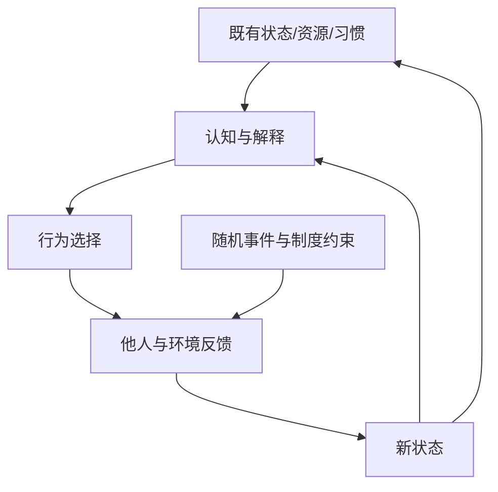

# 命运与受约束能动性：用动态系统思考选择与结果

## 核心判断

如果暂时将“命运”定义为一个人随时间真实经历的状态轨迹，那么它可被建模为**受历史条件约束、包含行为和环境反馈、又受到偶然扰动的动态生成过程**。

这是一个帮助思考的模型，**不是关于人的命运的可估计科学定律，更不是佛教、道教或斯多葛主义共同主张的一个数学公式**。

## 状态模型

```math
S_{t+1}=F(S_t,A_t,O_t,E_t,\varepsilon_t)
```

- \(S_t\)：当前状态，包括能力、资源、习惯、关系等历史沉淀。
- \(A_t\)：自己的行动、学习和选择。
- \(O_t\)：他人的行动与互动。
- \(E_t\)：制度、物理与社会环境。
- \(\varepsilon_t\)：不可预测扰动。

由于行动者的信念本身会变化，还可用 \(B_{t+1}=G(B_t,S_{t+1})\) 表示认知更新。**变量名称只是类比表达，不意味着已知真实函数或参数。**



## 路径依赖并非宿命论

过去经验会塑造人对刺激的默认反应。例如一次失败 → 自我否定 → 避免挑战 → 缺少练习 → 后续更容易遭遇失败。这是一个**可能存在的自我强化路径**，不是每个人失败后的必然反应。

改变其中一环（复盘、求助、练习、及时反馈），就会改变后续结果的条件分布，但不能保证某个目标一定发生。

| 命题 | 是否成立 | 理由 |
| --- | --- | --- |
| 过去形成的习惯和资源限制当前选择 | 通常有解释力 | 历史状态会进入未来决策 |
| 过去完全锁定未来 | 不能如此推断 | 当前行为和外部条件也会改变状态 |
| 只要改变认知就能确保成功 | 不成立 | 资源、他人行动与随机性仍有影响 |
| 能动性意味着影响状态转移的部分输入 | 有用的类比 | 不等于任何结果都可由个人决定 |

## 三个可迁移问题

1. **状态**：哪些既有约束短期无法改变？哪些其实是能够逐步调整的？
2. **回路**：我采取的行为引发何种反馈？正反馈增强的是能力，还是依赖与脆弱性？
3. **杠杆点**：哪一个可改变的输入最容易带来可观测的后续不同，而不是只追求最终结果？

这里的“自由”不必抽象地定义为决定一切；可以在方法层理解为：**在现实约束下提高有效选择与修正反应的能力**。但它不取代不同哲学传统对自由、无我或解脱的完整论证。

## 与相关知识的分工

- [[_wiki/SystemsThinking/反身性与反馈回路|反身性与反馈回路]]：关注“认知通过行为改变现实”，是动态系统的一个特定机制。
- [[_wiki/SystemsThinking/控制边界与最小必要干预|控制边界]]：关注哪一部分可以行动、怎样减少不必要副作用。
- [[_wiki/Philosophy/缘起无为与控制哲学比较|思想传统比较]]：防止把缘起、业、无为和古代斯多葛思想说成同一种现代工程理论。

## 资料与证据

- [命运作为动态生成过程（legacy）](../../systems-thinking/destiny-as-dynamic-systems.md)：条件概率、状态和随机扰动的初版抽象。
- [命运作为动态反馈系统（legacy）](../../systems-thinking/reflexivity-causality-and-destiny.md)：认知、选择、环境反馈与路径依赖的展开。
- [佛道因果与控制力旧笔记（legacy）](../../systems-thinking/buddhism-daoism-reflexivity.md)：思想类比和论证脉络，不能当作科学实证。
- 此处的数学表达式系学习用状态框架，不能解释为原著中存在的公式。

## 待更新

- 若在工程和产品中使用该框架，应指定可测量的状态变量、干预变量与反馈时间窗，避免使用无法检验的“命运函数”。
