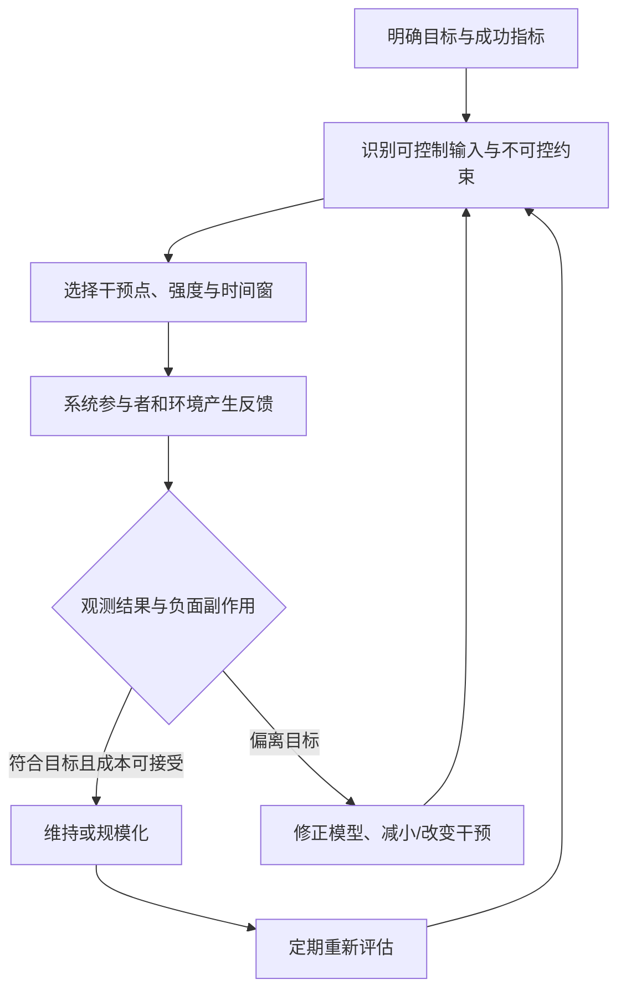

# 控制边界与最小必要干预：在复杂系统中采取有效行动

## 定义

复杂系统的结果同时受自身行动、他人策略、制度约束、历史状态和随机扰动影响。有效行动需要区分：**可直接控制的行动**、**只能间接影响的系统状态**、**短期不可控制的外部条件**。

“最小必要干预”在这里是工程决策启发式：避免把控制强度当作成功的替代指标；应设计可测量、可调整、有明确停止条件的干预。它并非所有情况下都应减小干预强度——事故止损、危害预防等场景可能需要强控制。

## 行动—反馈模型

可以用 \(S_{t+1}=F(S_t,A_t,O_t,E_t,\varepsilon_t)\) 理解：\(A_t\) 属于自己的可选择行动，但系统结果 \(S_{t+1}\) 受多方条件共同决定。“能施加影响”不能等同于“完全控制”。

## 关键区别

| 问题 | 合理分析 | 容易出现的误区 |
| --- | --- | --- |
| 控制边界 | 哪些动作由自己直接执行，哪些结果受他人和外部环境影响？ | 对结果许下超出能力的保证 |
| 反馈 | 行动后其他参与者如何适应？信息是否失真？ | 看到指标恶化只增加监控强度 |
| 杠杆点 | 哪个约束或激励改变后可以持续影响行为？ | 只增加流程、审批和惩罚 |
| 最小必要干预 | 给出干预目的、观测窗口、风险和退出条件 | 误解成永远“少做事” |

## 实例：把指标当目标

一个团队发现服务质量下降，于是只加强可量化的工单关闭数量 KPI。员工可能改变优先级，提高关闭数量但牺牲复杂问题解决率，导致真实体验恶化。管理者若仅继续提高关闭指标，就构成可能的强化反馈。

这类机制经常被讨论为**指标替代目标、目标扭曲或 Goodhart 型问题**；不能在没有数据时断言任何 KPI 都导致指标套利。

可设计的实验是：同时观测工单关闭率、复开率、客户问题解决时间、投诉和抽样质量；设置对照期与停止条件。若质量恶化，优先重新设计激励，而不是简单提高考核阈值。

## BAFL：从旧笔记提炼的行动检查表

旧文提出 BAFL，可作为个人学习用的四步框架，**不是广泛验证的学术算法**：

1. **Boundary**（边界）：确定自己能直接实施的行动。
2. **Awareness**（觉察）：检查习惯性反应、情绪和决策偏误。
3. **Feedback**（反馈）：跟踪参与者适应、二阶影响与滞后效应。
4. **Leverage**（杠杆点）：改变具有持续作用的约束、信息或激励。

“智慧 = Boundary + Awareness + Feedback + Leverage”应被理解为教学隐喻，不是可加总的测量关系。

## 与相邻概念

- [[_wiki/SystemsThinking/命运与受约束能动性|受约束能动性]]：分析个人选择与结果之间的条件。
- [[_wiki/SystemsThinking/反身性与反馈回路|反身性]]：若干反馈来自参与者认知。
- [[_wiki/SystemsThinking/胜利后的战略转型|战略转型]]：系统目标已经改变时，干预强度和分配结构需要复核。
- [[_wiki/Philosophy/缘起无为与控制哲学比较|哲学比较]]：道家“无为”、佛教觉察与斯多葛控制区分的思想背景与边界。

## 资料与证据

- [原有“行动与控制的统一框架”（legacy）](../../systems-thinking/action-and-control-in-complex-systems.md)：BAFL、控制边界与反馈的原始综合。
- [“缘起、反作用与反身性”（legacy）](../../systems-thinking/buddhism-daoism-reflexivity.md)：对道家无为的现代类比，非现代工程定理。
- Epictetus, *Enchiridion*, Chapter 1, [Greek text and translation](https://epictetus-enchiridion.org/en/chapters/enchiridion/01/)：古典控制边界议题来源；不等于现代控制系统的工程定义。
- 本文的 KPI 案例是机制性假设示例，不是对具体组织的实证调查。

## 待检验

- 每次工程应用应定义被控制对象、负反馈稳定性、观测延迟和不可逆风险。
