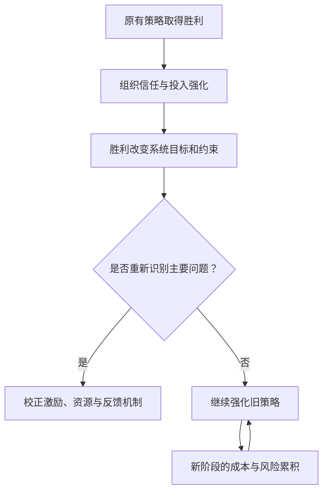

# 胜利后的战略转型：当原来的最优策略不再最优

## 定义

**战略转型问题**：系统在某一阶段用特定组织和激励机制取得成功，但成功本身改变了资源约束、参与者结构或系统目标。若继续不加区分地强化旧机制，原来的优势可能转化为新的成本和风险。

这不是“成功必然导致失败”的定律，而是一个需要结合具体证据检验的机制假说。

## 为什么重要

我们容易观察到已经奏效的行动，却不容易注意到“系统现在要解决的是否还是同一道题”。应区分三个层次：

| 层次 | 要问的问题 | 常见误判 |
| --- | --- | --- |
| 目标识别 | 当前追求的是扩张、整合还是稳定运行？ | 默认长期目标与上一阶段相同 |
| 策略适配 | 旧机制在新约束下的边际收益和成本是什么？ | 只回顾历史胜绩 |
| 反馈校正 | 哪些观测结果表明需要改变资源配置？ | 把负反馈解释成执行力度不足 |



## 历史案例：秦国与秦帝国

- **统一之前**：持续动员、军功激励和行政控制，有助于秦国赢得兼并战争。
- **统一之后**：新获得的地区要长期纳入财政、行政和政治秩序，原先的征服目标发生变化。
- **结果和局限**：秦朝出现严重的财政、政治和社会治理压力，又遭遇继承危机，最终速亡。不能把“路径依赖”单独当作足以证明的灭亡原因。

具体史实与证据限制见 [[_wiki/History/Questions/秦统一与秦朝速亡|秦统一与秦朝速亡]]。

## 与相关概念的区别

| 概念 | 与本页的关系 |
| --- | --- |
| 主要矛盾转化 | 描述特定历史阶段中优先处理的问题发生变化，是一种分析框架 |
| 路径依赖 | 描述已有制度、投入和信念如何提高后续更换策略的成本 |
| 组织惯性 | 描述即便外部环境变化，组织仍继续采用熟悉流程 |
| 激励相容 | 解释为什么有些策略对局部参与者有利，却未必符合新的整体目标 |
| 反身性 | 决策与预期会反过来改变系统状态；并非所有战略转型都依赖反身性机制 |

延伸旧文：[反身性与因果、命运](../../systems-thinking/reflexivity-causality-and-destiny.md)；[命运作为动态生成过程](../../systems-thinking/destiny-as-dynamic-systems.md)。这些文件目前属于 legacy 笔记，未全部编译进 LLM Wiki。

## 现实工程映射

例如，一个产品在早期通过集中决策和快速发版获得增长。进入成熟期后，新目标可能包含稳定性、权限隔离、可审计性和服务等级承诺（SLO）。此时继续把“发布速度”视作唯一成功指标，就容易把事故成本转嫁给用户和运维团队。

可操作的检查框架：

1. **阶段**：现在最重要的目标与以前有什么不同？
2. **约束**：当前实际瓶颈是资金、技术、协作、信任还是可用性？
3. **信号**：哪些观测结果会否定“继续沿用旧做法”？
4. **调整**：哪些能力应保留，哪些策略的强度、边界或激励需要变化？

```text
策略适应性 = f(目标, 约束, 参与者激励, 反馈速度, 历史积累)
```

这是一种概念性检查式，不是量化预测公式。

## 来源

- [[_sources/conversations/2026-10/qin-unification-conversation|秦史讨论来源节选]]：主要矛盾与博弈论的讨论线索，非完整逐字对话。
- [[_wiki/History/Questions/秦统一与秦朝速亡|秦统一与秦朝速亡]]：历史案例及其史料边界。
- 毛泽东：《矛盾论》（1937）：主要矛盾、矛盾特殊性和阶段性变化的后设分析工具。
- [原有系统思维笔记：命运作为动态生成过程](../../systems-thinking/destiny-as-dynamic-systems.md)：反馈、路径依赖和状态转移的相关讨论。

## 待验证

- 如何为不同领域设计“旧目标已不再优先”的前瞻指标，而非仅依据失败事后归因？
- 在何种条件下强动员机制统一后仍保持收益，何种条件下出现成本反转？
