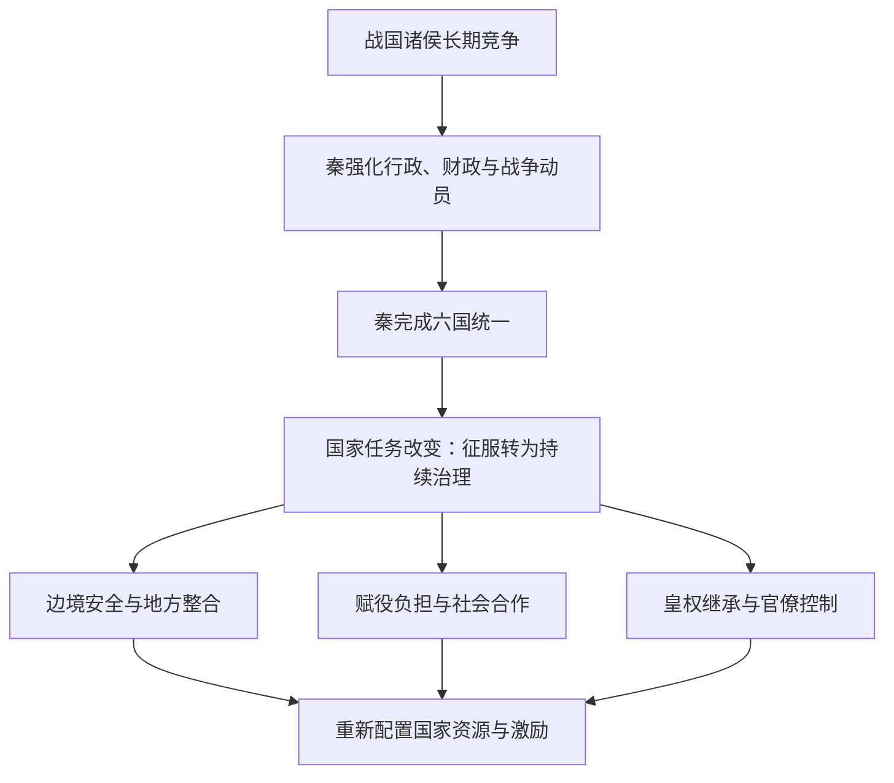
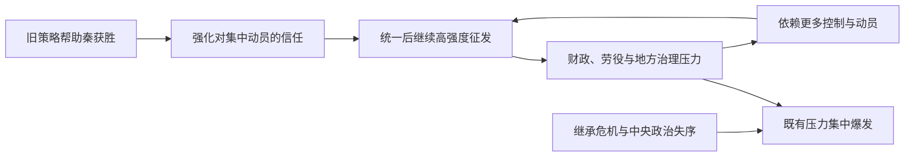

# 秦始皇为何能统一六国，却没能让秦朝长治久安？

> **核心洞察**：秦国在竞争阶段需要解决的问题，是如何比六国更有效地组织战争；统一以后需要解决的问题，是如何让新帝国持续获得资源、合作与服从。两种任务对国家能力的要求不同。过去的成功制度可以继续发挥作用，也可能因运行强度和目标没有调整而积累新风险。
>
> **分析工具**：动态联盟博弈、可信承诺、委托—代理、主要矛盾的阶段性变化、系统反馈与路径依赖。它们用于解释史实，**不代表秦始皇掌握现代博弈论，也不代表他读过《矛盾论》**。

## 一、先看一个反常识的结果

公元前230年至前221年，秦国先后灭韩、赵、魏、楚、燕、齐，用约十年完成六国统一。秦始皇前210年去世，秦朝前207年灭亡：从统一到灭亡仅十四年左右。

这并不等于秦国用了十年从弱小崛起。秦国的优势来自更长时间的制度建设和战争积累：商鞅变法、巴蜀地区的取得、秦昭襄王时期的扩张、对东方诸侯的持续消耗，以及军功、财政、行政和后勤组织能力。秦始皇继承的是实力显著领先、但仍然可能战败的秦国。

秦的统一战争有真实的不确定性。赵将李牧曾挫败秦军；攻楚时，李信率军失败，秦王政后来重新任用王翦。关于二十万、六十万军队的具体数字及君臣对话，主要出自《史记》，不应按现代审计精度理解。

**真正的问题不是“秦为什么强”，而是：为什么能够解决统一问题的国家，在完成统一后没有建立同样稳固的长期统治？**

### 时间线：不要把“即位”当成“亲政”

| 时间 | 事件 | 应如何理解 |
|---|---|---|
| 前259年 | 嬴政出生 | 年龄须区分周岁与传统虚岁 |
| 前247年 | 继承秦王位 | 大约13虚岁，即位不等于独掌朝政 |
| 前238年 | 冠礼、嫪毐之乱 | 秦王命臣下平叛，开始进一步掌握实权 |
| 前230—前221年 | 秦灭六国 | 主要征服战争约十年 |
| 前221年 | 称始皇帝、推行全国性制度整合 | 从诸侯兼并进入帝国治理阶段 |
| 前210年 | 秦始皇去世 | 随后出现继承与中央政治危机 |
| 前207年 | 秦朝灭亡 | 不能仅用单一原因解释 |

## 二、征服阶段：为什么六国知道危险，却无法持续合作？

想象秦国是一个不断增强的竞争者，六国都知道秦的扩张可能危及自身。**共同威胁并不自动产生稳定联盟。**

加入合纵联盟要立刻出兵、出粮、放弃单独媾和的选项；而参与联盟的安全收益，却可能被没有出兵的邻国共同享受。更棘手的是，各国彼此也在争夺土地，难以信任盟友会不会提前撤军、背后议和，或在战后要求重新分配战果。

一个简化的策略矩阵可以帮助理解，但它不是经史料校准的收益矩阵：

| 本国选择 \ 其他诸侯选择 | 共同抵抗秦 | 各自与秦周旋 |
|---|---|---|
| **承担抗秦成本** | 有机会遏制秦国，需协调出兵与收益 | 单独承受高军事成本 |
| **暂时观望或媾和** | 短期保存实力，分享盟友提供的安全 | 各国逐渐被分化，后续议价能力下降 |

这个模型揭示三种机制：

1. **集体行动困境**：每国都希望其他国家多承担抗秦成本。
2. **可信承诺不足**：今天的盟友未必愿意为明天的联盟继续支付代价。
3. **时间偏好与风险转移**：保存眼前实力可能使未来的战略处境更差。

这里不宜直接称为“囚徒困境”：六国的地理位置、军事实力、战争成本与收益都不对称，联盟更接近多参与者、动态且不完全信息的战略互动。

### 秦改变了什么？

秦不必在每个时点同时击败六国。通过军事压力、外交分化、利用各国间的旧有矛盾与逐次进攻，秦可以使六国面临不同的即时选择。例如齐国在秦灭其他诸侯过程中没有形成足以改变局势的军事干预，最终在外交和军事上趋于孤立。

可以把秦的做法理解为：**不只提升自己的胜率，还改变对手合作的成本与预期收益。** 但这个能力属于秦国长期发展出的国家体系和历代君臣，不能全部归功于嬴政一人。

### 秦国内部也存在博弈

王翦统率大军伐楚，涉及典型的委托—代理难题：君主要依赖有能力的将领，又担心将领坐大。《史记·白起王翦列传》写王翦多次要求田宅赏赐，后人可以用“发出缺乏政治野心的信号”解释这一行为。**这是现代解释，不是可以直接证明的秦始皇心理活动。**

## 三、统一意味着国家目标改变

战争时期，资源动员是目的明确的：组织军队，战胜对手，扩张国土，获得战略纵深。

而在前221年以后，原先的“敌国”变成国家内部需要治理的人口和地区。国家必须解决新的问题：如何征收而不破坏生产，如何治理旧六国地区，如何让官员履职，如何管理边境军事威胁，如何完成权力交接，以及如何把统治从持续征服转化为可持续的日常秩序。

这里可以借用《矛盾论》中“主要矛盾及其地位随着条件变化”的分析视角。但《矛盾论》写于1937年，不能说秦始皇在思想上提前实践了这本著作。



| 阶段 | 国家首先要回答的问题 | 倾向使用的能力 | 潜在副作用 |
|---|---|---|---|
| 战争竞争 | 怎样集中力量击败对手？ | 集权、征兵、动员、军功激励 | 长期财政与人口消耗 |
| 帝国建立 | 怎样整合新征服地区？ | 官僚行政、统一标准、交通建设 | 制度推行和征发的社会成本 |
| 长期治理 | 怎样在低冲突成本下持续获得合作？ | 可持续税赋、行政反馈、地方整合、稳定继承 | 若仍依靠高强度控制，成本可能扩大 |

**“主要矛盾变化”不等于战争需求消失。** 秦仍然面临北方边境问题、南方扩张与新领土整合。因此，问题不是应否完全停止国家动员，而是既有动员强度是否与帝国的长期承受力匹配。

## 四、秦朝速亡可以用“成功后的路径依赖”理解吗？

这是一种解释，而非已经被证实的唯一原因。

秦制中的郡县行政、统一文字和度量衡等，确实有助于帝国整合，并被后世继承和改造；不能因秦朝速亡，就断言秦国全部制度设计失败。

但大规模工程、军事与徭役征发、严厉行政控制，以及高度集中的权力结构，使帝国需要持续维持较强的资源提取和组织能力。统治资源被长期占用，社会抵抗和行政失灵的成本就可能逐步上升。这里应把多种原因共同考虑，而非把秦亡归咎于某一项工程或某条法律。



这个反馈图表达的是一个可讨论的因果机制；并非每条箭头都有可以量化的历史数据支持。

秦始皇前210年去世后，宫廷继承和官僚政治发生重大变化；胡亥时期的政治清洗与秦末起义进一步破坏了国家秩序。**继承危机是加速器，长期存在的治理负担则是需要一并讨论的结构性背景。**

如果秦始皇再活二十年，前210年发生的那次继承危机自然不会按原样出现；但是否能够降低统治成本、缓和社会矛盾、培养可靠继承人，则没有历史证据可以直接回答。这属于反事实推演，不能说成确定结局。

## 五、他个人究竟强在哪里，局限又在哪里？

评价秦始皇必须分清两套因果：

- **秦国制度与积累**：商鞅以来的国家组织能力、巴蜀经济与粮食基础、历代战争削弱对手、官僚与将领协同。
- **嬴政的决策与权力整合**：年轻时平定嫪毐之乱并逐步亲政，组织最后阶段的兼并战争，伐楚失败后改变用人决策，统一后推动帝国级的标准化与行政建设。

所以，“他靠一个人打败六国”不符合国家竞争的实际；反过来，“秦已经很强，因此换谁都能十年统一”也无法由史料证明。

秦始皇的重要历史地位更接近于**制度整合与历史转型的实施者**。他不是郡县制的发明者，却推动把战国时已发展的行政技术运用到全国性帝国的尺度。汉朝继承并调整这些基础制度，这比秦朝本身十四年的寿命更能说明其长期影响。

## 六、与欧洲相比：为什么秦汉之后不断出现“再统一”？

拿秦统一六国直接对比“欧洲两千年没能统一”，问题在于比较对象不对等。罗马曾统一地中海世界的大面积领土，却没有统一现代意义上的整个欧洲。更有意义的是比较：**为什么秦汉的统一帝国模式后来被多次重建，而西罗马帝国瓦解后，欧洲西部长期保持多中心政治结构？**

研究中常讨论地理连通性、行政制度的延续、政治合法性观念、交通与经济联系、对外军事压力等因素。任何单一因素都不能直接解释两千年的全部历史。

还需要区分两层“统一”：一是某次战争的胜利；二是此后统治者和社会长期把大范围政治整合视为可操作、可继承的国家形态。**秦汉在第二层留下的制度经验，可能比一次战役的胜负更持久。**

如果秦始皇统一失败，可能由另一个强国完成统一，也可能形成长期多国均势，甚至统一与分裂反复交替。现存材料不足以给这些假设赋予客观概率。

## 七、把秦朝的案例转化为一个可用的系统模型

一个组织在不同阶段面对不同约束。创业团队最初需要快速试错、集中决策；成熟产品则可能更关心可靠性、职责边界与长期维护。战争与企业当然不是同一种对象，但“目标改变导致原有策略的相对收益改变”具有可迁移的分析价值。

可以用四个问题检查自己是否还在高效地解决**上一个阶段**的问题：

1. **目标**：当前系统的成功标准是什么？与上一阶段相比改变了什么？
2. **瓶颈**：真正限制目标实现的是资源、协同、合法性、成本还是反馈速度？
3. **策略**：原先有效的机制，现在仍创造收益，还是正把负担转嫁给其他部分？
4. **反馈**：什么事实会迫使我们承认主要矛盾已经转移，并改变资源配置？

形式化地写成一个启发式模型：

```text
策略适应性 = f(当前目标, 约束条件, 参与者激励, 信息反馈, 历史路径)
```

它不是经过估计的科学定律，而是一种决策检查表。

> **结论**：秦国最重要的能力之一，是把长达百余年的制度和军事积累转化为统一战争的成果；秦朝的困境，则提醒人们，完成原定目标会改变整个系统的边界条件。真正困难的战略转型，往往发生在旧策略刚刚赢得最大成功之时。

---

## 史料、研究与方法边界

**一手史料**

- 司马迁：《史记·秦始皇本纪》——秦王政亲政、灭六国、帝国政策与继承危机。
- 司马迁：《史记·白起王翦列传》——王翦、李信、灭楚战事等叙事。
- 司马迁：《史记·吕不韦列传》——嫪毐与吕不韦相关的宫廷政治叙事。
- 司马迁：《史记·陈涉世家》——秦末起义的传统记述。

**理论与比较史**

- 毛泽东：《矛盾论》（1937）。本文借用主要矛盾、矛盾特殊性等概念作为现代分析视角。
- Walter Scheidel (ed.), *Rome and China: Comparative Perspectives on Ancient World Empires*, Oxford University Press, 2009。
- Walter Scheidel, *Escape from Rome: The Failure of Empire and the Road to Prosperity*, Princeton University Press, 2019。

**证据界限**

1. 《史记》写于秦亡之后，其数字、动机与戏剧化对话需与出土文献和其他研究交叉核对。
2. 联盟博弈、可信信号、路径依赖是现代解释模型，不能倒推秦始皇“精通博弈论”或实际采用某一现代模型。
3. “秦始皇多活二十年”“中国如果没有统一会不会像欧洲”等问题属于反事实情景，只能做条件推演。
4. 秦亡有政治、军事、财政、社会和继承等多重原因；本文提出的是一条解释链，而非排他的单因结论。

**整理方式**：本文由秦史与战略思维讨论重写，不是《史记》《矛盾论》或上述研究著作的逐章摘录。
